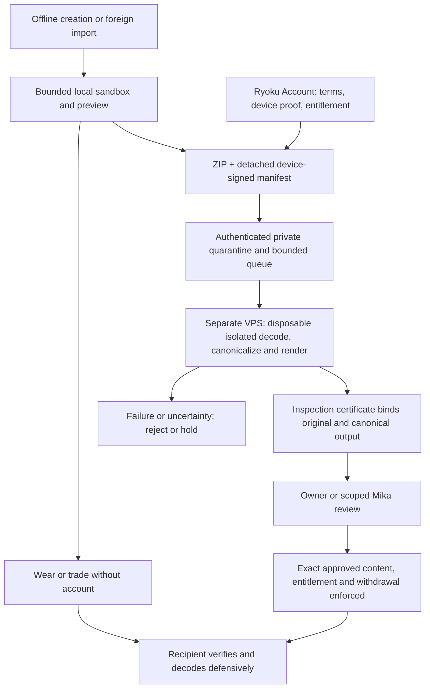

# Card system security

The card system has an offline creation and trading path, and an online account,
inspection, review and sync path. This guide records their trust boundaries,
the private candidate's controls and the remaining deployment requirements.
Implemented source is not public availability: configuration, authenticated
end-to-end proof and owner acceptance are separate gates.

## Two domains, one optional account

**Offline:** creating, importing, wearing and trading a card does not require a
Ryoku Account. An imported asset or a friend's card is still foreign input. It
needs bounded parsing, isolated decoding and defensive rendering whether it
arrived from the gate, a clipboard, a chat app or a USB drive.

**Online:** Ryoku Account provides shared sign-in, account security and purchase
access. Ryoku Ember is a separate optional hosted AI provider for curated
open-weight models; its planned OpenAI-compatible `ai.ryoku.dev/v1` API is not
publicly activated by this work, and it is not a desktop-installation
requirement. Creator is a separate $2/month online-card
subscription on the same account and Stripe customer. Card publication and sync
never spend Ember credits; monthly Ember refills are finite, not unlimited.

Share the account ID, not authorization. Future inference-only Ember keys must
not authorize binders, subscriptions or account management. This candidate has
Account sessions/OAuth, not an external Ember key issuer; relabeling those
sessions as API keys would grant the wrong authority.

The selected product shape is:

- Ordinary still cards remain shareable without an account or review.
- Supported GIF/WebP animation can be created and worn locally without an
  account, badge or subscription. Existing local video remains badge-only and
  is excluded from hosted custom-design/hero submissions.
- Online animated sharing needs a valid existing badge entitlement or an active
  Creator subscription, checked server-side. Existing owner-only styles remain
  owner-only; buying Creator does not grant a badge or the owner's design.
- Every in-scope custom animated submission is a ZIP with an explicit checklist,
  a device-signed manifest, independent inspection and a review decision.
- Public animated uploads support bounded GIF/WebP, not arbitrary video, QML,
  scripts or plugins. Private/local video behavior is a separate concern.
- Hosted publication starts SFW while Stripe is the payment rail. The applicable
  processor, hosting and legal requirements must be checked before changing that
  boundary; calling adult hosting free or renaming the charge is not a guarantee
  of compliance.

## Current private candidate

These are implemented source boundaries, not a claim that every installation
has provisioned their services or authorities. Public rollout remains disabled
until the complete candidate is exercised and accepted.

| Part | Source | Responsibility |
|---|---|---|
| Card gate | `release/team-badges/` | Private signed intake, bounded durable queue, scoped review, certified publication, withdrawal and v5 record enforcement |
| Local backend | `ryoku/hub/backend/` | Device provenance, bounded media sandbox, offline imports, Account linking/submission and recipient verification |
| Studio and binder | `ryoku/hub/quickshell/components/about/` | Canonical-media presentation, explicit consent/checklist controls and default-off live sync |
| Account service | separate `ryoku-accounts` project | Clerk identity, independent Account/card consent receipts, device proofs and separate Creator/Ember billing families |
| Inspector | `release/team-badges/inspector/` | Credential-free disposable decoder/real-renderer containers and a separate trusted supervisor/signer |
| Review console | existing `ryoku-account-web` project | Restricted searchable submissions, certified previews, evidence and audited decisions |
| Local reviewer | `release/team-badges/reviewer/` | Bounded certified PNG/text review with the existing local model and restricted publication signatures |
| Hosted-card safety | `release/team-badges/src/card-safety.js` and the Account site's OwnerSafetyPanel | Private reports/appeals, owner-only decisions, scoped restrictions and Account closure purge |

### Identity and who signs what

`devicebadge.go` generates a random Ed25519 seed in the local private
`device.key` file. The card ID is the first eight bytes of the domain-separated
SHA-256 of its public key, not `/etc/machine-id`.

Browser signup, signed-in Account status and Creator checkout do not create a
desktop key or link a card. Local card tooling creates its key on the desktop
when used; online linking is a separate exact-action proof. Reading Account
status checks an existing identity without manufacturing one.

A badge (`RYB`) binds a login and role to a device public key. The owner or Mika
signs that badge. The device signs its own published card records. The badge's
signature and the device's signature are different authorities.

The Worker `OWNER_KEY` and `MIKA_KEY` variables are **public verification keys**.
The Worker verifies signatures; the existing owner/Mika private seeds do not
belong in its configuration. `badgecrypto.go` supports owner keyring/private-file
signing and Mika private-file signing. That source alone does not establish the
physical custody of every deployed private key.

A device signature proves possession of the corresponding key and integrity of
the signed statement. It does not prove a legal identity, authorship, copyright,
consent of depicted people, or that a file was safely inspected.

### Still sharing and live records

A shared still card carries its design in visible tick rulers. PNG metadata is
only a convenience; the image must remain restorable after chat recompression
strips that metadata. CRC and Reed-Solomon recover or reject damaged ruler data;
they are not a cryptographic signature and do not prevent an attacker from
creating a different valid code.

`cards.go` decodes a bounded picture, reads the rulers, re-derives a binder entry
and keeps the cropped picture window as a newly encoded PNG. Stored paths are
pinned to the card ID and checked as regular files. A ruler-only import must not
gain a badge, verified login or owner-only style from the pixels.

`cardrecord.go` binds card identity, timestamp, design data and an optional
JPEG hash in a device signature. Legacy v2–v4 sync transports a still picture;
local GIF playback alone does not make that transport animated. The v5
publication-bound format below is a separate contract.

Classic v2 records can prove their device key without a badge. Styled v3 and
worded v4 records have extra active-badge and style-ownership requirements. The
receiver maps the card ID to verified badge information where available, and
re-checks both the record signature and picture digest.

### Private intake and exact publication

New custom designs and hero animations use authenticated reservation, private
quarantine and a detached `ryoku-submit-v1` device signature. An issuer-signed
upload, client success flag or content hash is not inspection authority or
permission to read quarantine. Pending legacy issuer reads require their own
issuer proof; they are not a public new-submission path.

The Gate checks the real account/device binding, both consent scopes, current
badge-or-Creator eligibility and every signed inventory/hash/checklist field.
It holds original bytes privately while a separately authenticated worker
leases the job. Only independently certified canonical output can reach review.
There is no legacy publication alias for new uninspected bytes.

Authenticated Account and signer requests use manual redirects and reject
non-success responses rather than following an authority to another origin.
Workers does not implement fetch's `redirect: "error"` mode; using it would
reject a valid authorization request before any network I/O.

An inspection certificate does not publish a design. Content review, an
authorized decision and an exact restricted `ryoku-design-approval-v3` signature
are distinct steps. The Gate rechecks current eligibility, bindings, review,
certificate, decision and withdrawal state before publication and direct reads.
`RYX` remains badge revocation; content withdrawal has its own state and audit
history. Revoking either cannot erase a copy already held by another person.

The restricted review dashboard searches job, card and account identifiers within
the selected queue state. Original and canonical downloads are explicit actions;
the ordinary preview uses only certified output. Manual review does not pretend
to have run model composition analysis, and zero-frame coverage must explicitly
remain uncertain. Recording owner approval intent alone never publishes bytes:
the registered restricted signer must still bind the exact certificate and decision.

Mika may approve only a fully covered clean result. It cannot reclaim an
uncertain or owner-reviewed hold, reject it, or request changes; those decisions
belong to the owner. A submitter's withdrawal is job-scoped, audit-preserving and
idempotent, committed before object deletion. It must not revoke another
publication with identical canonical bytes. Hash-global content takedowns remain
a separate owner-only action.

### Existing input defenses

The Go backend has useful hostile-input defenses and tests:

- Header-before-decode dimensions/pixel bounds in `imageinput.go`.
- GIF block walking and WebP canvas/frame/composited-pixel checks in
  `profilepicture.go` and `webp.go`.
- Strict ZIP names, regular files, methods, ratios, count and total-byte budgets
  in `designpack.go`; symlink and file-replacement checks for local reads.
- A strict data-only `design.json` and aggregate decoded-pixel budget in
  `design.go`, including otherwise unused assets.
- Domain-separated Ed25519 signatures and signed picture hashes, verified
  independently by gate and recipient.

Foreign images now cross the same-binary bubblewrap boundary before trusted
host decoding or Qt presentation; strict result validation runs again in the
parent. Qt and other codecs still parse canonical output and remain an attack
surface. Re-encoding reduces exposure to original container structure; it does
not guarantee safe content, decoder correctness or removal of steganography.

## Processing and authority boundaries

### The local decoder

The backend uses a one-shot same-binary child with private input/output pipes,
empty inherited credentials, separate user/mount/PID/network/IPC namespaces,
no host home, bus, abstract socket or `/proc`, and only individually allowlisted
ELF executables, interpreters and required libraries. It never binds the host
root or an entire Nix store. `/dev/null` is the only device, mounted with device
semantics; no GPU or other host device is exposed. Bubblewrap must support both
explicit user-namespace creation and disabling further user namespaces.

Wall time is 30 seconds per media job and cumulatively per design pack; CPU,
address-space/data, processes/threads, descriptors, output and scratch storage
are bounded. These are local rlimits and tmpfs bounds, not aggregate cgroup
memory accounting. Decoder, filter and encoder thread counts are explicit.
Missing tools, unsupported isolation, timeouts and resource failures refuse the
operation visibly, never fall back to unsandboxed decoding.

GIF/WebP decoding and re-encoding preserves every supported frame's timing,
disposal, blending, transparency and loop semantics. The parent independently
checks format, dimensions, frame/timing facts and output budgets. All assets,
including unused ones, are canonicalized before design preview/wear. The Qt
chooser and binder receive only newly canonical paths, not the original file.
Legacy local video is converted to bounded metadata/audio-free WebM and its
inspection facts are explicitly poster-only, not full-timeline coverage.

Required executable capabilities ship in every package lane: bubblewrap,
`cwebp`/`dwebp`, `ffprobe`/`ffmpeg` with the existing video encoder, and the
platform's Secret Service support for online sessions. Card isolation does not
depend on one particular init system.

### Account consent and device ownership

The signed-out site explains the desktop key before signup, then authenticated
onboarding records explicit current Account acceptance before paid/hosted use.
It does not claim browser signup already generated a key. Separate optional
card consent repeats exact key custody, compromise/unlinking and reviewed-action
disclosures. Offline creation and static sharing require neither acceptance.

Receipts are append-only and independently scoped `account` and `cards`, binding
document/disclosure hashes, policy version and server time. Account acceptance
covers terms/privacy/refunds and allows Ember or Creator checkout without card
rights/key checkboxes. Linking/submission requires both current scopes plus the
independent exact-content checklist. Legacy combined receipts grant neither new
scope; a missing, stale or string-valued acceptance is not assent.

Link a device through an authenticated account session and a short-lived,
one-use challenge bound to the device public key, account, intended origin and
action. A device signature over a caller-supplied account string is insufficient.
Handle multiple devices, unlinking, replacement and compromise explicitly without
silently cloning keys, merging card identities or reissuing badges.

Creator entitlements are independent of Ember credit purchases and spending.
Check active access at the service boundary, including simultaneous subscriptions,
payment event replay/order, paid-period expiry and revoked bindings.

### ZIP checklist and detached submission manifest

Before signing, show the actual preview and distinguish automatic check results
from user affirmations. Automatic rows cover archive/assets/isolated preview;
user checkboxes cover rights, policy and permission for inspection/review. A
failed or incomplete check cannot appear green.

The device signs a versioned manifest binding the original ZIP hash, allowed file
names/hashes/lengths, device identity, policy/attestation version, intended
service/action and submission freshness. The service derives account ownership
from authentication and the verified binding, not arbitrary manifest text.

Keep the whole-ZIP manifest/signature detached. Including a whole archive's hash
inside that archive creates a self-reference. Specify exact canonical signed
bytes and cross-language vectors; JSON field ordering must not be accidental.

The client's results are pre-flight UX and load reduction, not inspection proof.
Anyone controlling an open-source client can bypass a check and still sign.
A scanner certificate is also a signed assertion whose reliability depends on
its signer and implementation, not a mathematical guarantee of harmlessness.

### Separate VPS and Docker isolation

A network hop alone adds no protection. The separate VPS provides another
kernel, credential boundary and failure/resource domain away from Mika and the
homelab. A VM on the same host can add a guest-kernel boundary; ordinary Docker
alone shares the host kernel.

Run per-job isolation inside the VPS too: nonroot, no capabilities, no new
privileges, read-only runtime, no network or host sockets/devices, and explicit
resource/time limits. Never expose the Docker API or put its socket in the
hostile worker. Keep the inspector signer and service credentials outside that
worker. A compromised decoder cannot be allowed to sign arbitrary claimed passes.

The inspector validates original provenance, canonicalizes every asset and
renders the rebuilt card with the real trusted renderer. The same preview/report
must be hash-bound to the output reviewed and eventually served. Original input,
canonical output, inspection result and review decision are separate immutable
objects linked by hashes.

A certificate binds the job, original manifest/archive, canonical package,
output inventory, preview/report, scanner key/build/policy and actual coverage.
Distinguish technical pass from unreviewed, unavailable, clear or flagged content
review. Missing services do not become clean results.

The private runtime uses the root-only launcher's `--renderer` profile for
**both** decode and render, with 1,258,291,200 bytes (1200 MiB) memory and no extra
swap, 2 CPUs, 64 PIDs, a 180-second deadline per stage, 512 MiB work, 64 MiB tmp
and 16 MiB shm, the separate 512 MiB media profile is not this pipeline's budget

The exercised image is
`sha256:41c99c7e87e644dbc5e7ca452adf7844ffe9b6ab0dc382d45b737eb871be1722`
and renderer manifest is
`72b4024e14eeb1028c2b4bcfd3e92f26239ee835614188aceba86638f1beed26`,
the renderer remains private and its redistribution terms still apply

Capacity fixtures passed real decode and render for 96 frames at 816×816
(63,922,176 decoded pixels over 19.2 seconds) and a separate two-frame 2048×2048
canvas, with ten hostile inputs refused, the aggregate run took 115.538504
seconds and observed at most 743,366,656 bytes (708.9296875 MiB) and 15 PIDs

These are fixture-transport observations, not HTTP load or p95 guarantees,
the 96-frame content review is incomplete and remains unreviewed

### Queue and waiting

Authenticate and reserve quota before accepting expensive work. Return an owned
job/status handle instead of keeping an upload HTTP request open throughout
inspection and human review. Bound per-account outstanding jobs, global jobs and
bytes, worker concurrency, abandoned uploads and failure recovery.

Measure actual worker service time, peak memory and tail latency before claiming
capacity. Show a queue estimate only after observations support it; keep technical
scan ETA separate from human review time. On overload, refuse admission with an
explicit retry hint rather than accept an unlimited backlog.

Current admission keeps one worker, twenty global queued jobs, two waiting per
Account, eight admissions per 24 hours and a 464 MiB byte budget, burst and daily
denials with Retry-After were exercised privately, an expired inspection lease
fails rather than silently retrying forever

Keep public API/object traffic at the edge. Mika's host need not proxy every
animation download. The VPS must not gain a broad route into the private LAN or
credentials that delete off-host backups.

### Owner and Mika review

The existing Account frontend implements a restricted searchable review panel;
the intended team origin is `team.ryoku.dev`, not an already-authorized public
deployment. It presents certified full-card animation, source-frame evidence,
asset inventory and inspection/attestation details. ZIP download is an explicit
evidence action before decision, never automatic execution or rendering of a
raw original on the reviewer's host.

Owner review uses an authenticated authorized human identity. Mika uses a scoped
service identity, not a shared browser account or an unrestricted issuer seed.
She may approve only technically passed, content-clear work; flags, uncertainty,
appeals and exception requests go to the owner. Neither reviewer can turn a
failed technical inspection into a passed certificate.

Uploader-controlled image/text content is evidence, not instructions to the
reviewer agent. Approval tools independently enforce state and scope even when
a model is tricked. Record every decision's identity, time, reason, exact output
and idempotency key. Changed bytes require fresh inspection and approval.

Bind verifiable approval to the canonical content and inspection evidence.
Extending RYD requires a versioned contract, not silently changing RYD v2's
meaning. Keep broad owner/Mika private keys out of the scanner, gate and browser;
automation needs restricted delegation or a separately controlled signer.

Mika review version `mika-local-card-review-v2` requires every original source
frame when the complete timeline fits the eight-frame automation budget,
**plus** the real composed poster and all typed canonical design text. Both
images and text are untrusted evidence, not agent instructions. The inspector
binds these to the exact canonical ZIP, poster, preview and final report.
Its certificate remains `unreviewed`; the local model produces a separate
immutable assessment. A sampled preview is not exhaustive composed-timeline
coverage or proof of legal rights.

The Ally client accepts only independently verified, stripped bounded PNGs and
text. It validates chunks/CRCs/inflate bounds without a native media codec,
uses an authenticated literal-loopback local model with no cloud fallback,
checks idle slots before each request and serializes its work. More than eight
source frames, missing composition, flags, uncertainty or unavailable inference
withhold automatic signing and go to the owner. Fair pagination skips held jobs
without starving later eligible work. A resumed signature rechecks the fresh
certificate and actually re-reviews the evidence, never trusts cached clear.

### Animated sync and the signed classification

A GIF/WebP is one immutable file containing many frames. Normal playback changes
the displayed pixels, not its file bytes. Verify the complete animation/package
and keep that verified state during playback; do not hash each frame against a
static poster and call it unsigned.

Re-encoding or changing the underlying file changes its digest. A new output
needs a new linked inspection/approval rather than being mislabeled as the
uploader's original signed bytes. The user's signature authorizes the original;
the inspector links it to the transformation; the reviewer authorizes publication
of the exact transformed output.

V5 records bind the immutable approved publication, canonical content and still
fallback separately in a device signature. Publication approval and inspector
keys come from an independent trust registry, never the downloaded pack itself.
Gate and recipient check current authority, hashes and withdrawal semantics;
recipient parsing and decoding remain bounded even for certified media. Missing
authority fails closed. Legacy v2–v4 still verification remains supported.

The private website-authorized ZIP, VPS inspection, Mika/owner restricted
approval and native recipient-animation round trip has been exercised for design
and hero fixtures, including playback-stable signed status and scoped withdrawal

This used Clerk website authentication and source/helper signed v5 writes,
not native OAuth, that flow still needs the owner's exact private resource-scope
registration and its own authorization proof before it can be called complete

### Reports, appeals and Account closure

Reports enter private owner triage first and do not automatically hide content,
Mika cannot resolve safety cases or impose restrictions, the existing Account
site provides `/card-safety` separately from Creator and device onboarding

Implemented Gate routes in `src/card-safety.js`:

- `POST /v1/card-reports` binds a hosted card/publication and its complete signed
  visual-content fingerprint, not only its picture bytes
- `POST /v1/submissions/:id/appeals` accepts the submitting Account's reason for
  rejected, changes_requested or failed work, it cannot waive a technical failure
- `GET /v1/card-safety` reads only the caller's cases, without requiring Creator,
  a linked device or current card-policy consent, closed Accounts are denied
- Owner-only `GET /v1/review/safety` and
  `POST /v1/review/safety/:id/decision` allow report dismiss/withdraw and appeal
  dismiss/resubmit, a resubmit invitation starts a fresh ordinary full pipeline
- Owner-only `POST /v1/review/card-restrictions` targets exactly one Account or
  card, it pauses new card submissions/publication, not Account sign-in, Ember
  credits, inference or billing, old content needs an explicit withdrawal

Requests use bounded data-only reasons and durable idempotency, cases last
90 days with caps of 32 per Account, eight admissions per 24 hours and 256 global,
restriction history is bounded to sixteen changes per target and 256 targets

Queued submissions expire after one day, unpublished review after seven days,
approved publication after ninety days and terminal metadata after one day,
these are implemented limits rather than a legal retention approval

Account closure is implemented in the separate Account service's `src/closure.ts`,
`DELETE /web/api/account` requires the verified own website identity, configured
Origin and exact `DELETE <own Account ID>` confirmation, it closes online
authority immediately and prevents stale sessions from recreating the Account

Durable cleanup purges Account-owned hosted content, cancels only separately
bound future Creator/Ember renewals and deletes the configured Clerk identity,
it preserves local cards/keys and billing/security receipts without inventing a
refund, website 200 returns `{deleted:true,localCardsPreserved:true}` only when
cleanup finishes, 202 explicitly means closed with retryable cleanup pending

`POST /internal/inspection/accounts/close` uses the distinct Account-to-Gate
bearer and exact audience, not worker or Mika credentials, the Gate snapshots
and purges at most 32 work units per request with durable resumable 202,
Account accepts only HTTP 200 containing all three matching fields
`{accountId:expected,closed:true,purged:true}`

The signed Svix `POST /v1/clerk/webhook` handles `user.deleted` and refuses missing
verification config or invalid signatures, synthetic HMAC fixtures remain
distinct from actual producer delivery

Real private Clerk TEST delivery now passed through a deletion-only development
Svix endpoint and official Clerk CLI relay, SDK deletion reached the unchanged
handler with 200 and a still-unexpired frontend-bound credential then received
403 account_closed, invalid HMAC returned 400 without closing the Account

This does not enroll an enduring public/production endpoint or prove native
OAuth, a BAPI session JWT without azp was refused and the fixture then signed
in through the real hosted UI, ordinary second signup was bot-blocked rather
than silently counted as passed

Three review findings have failing-before regressions: the full signed visual
fingerprint, CAS snapshots that preserve later independent static publications,
and batch refusal of unchanged withdrawn static cards, source tests do not
substitute for real lifecycle proof

Private report/appeal UI, cards-only pause and ordinary-account safety isolation
are exercised, ordinary reporters need no entitlement/card consent but cannot
read owner cases, decide them or act for another Account, explicit owner static
withdrawal returned 404 while an unrelated approved publication stayed available

Real browser Account closure also passed on a separate disposable fixture,
stale verification was refused, normal password sign-in refreshed it and the
exact confirmation returned 200, both TEST Creator and Starter subscriptions
were canceled, Clerk identity and hosted static/raw ZIP returned 404, the job
remained withdrawn and the same local key/card identity and 0600 mode survived

The original gallery Account remained available with 110 Ember credits

Additional isolated Stripe TEST clocks exercised finite Ember refills, paid
Creator renewal, scheduled cancellation retaining paid access, the exact paid
period end, and a failed Ember renewal preserving already paid credits

A genuine Creator dispute blocked only its bound order, duplicate risk and late
paid-invoice delivery could not restore it or mint/freeze Ember credits, and
another Creator checkout was refused, the disposable identities and their
future subscriptions were closed after verification

Stripe's clock advances Stripe only, paid-period boundary verification executed
the unchanged entitlement source against actual persisted state at the explicit
provider time, it did not advance Account HTTP/auth clocks or invent grant rows,
an initial wrong clock expectation was corrected without changing product code

A separate trusted-service fixture forced the 32-work purge boundary with 17
own static card IDs, returned 202 and resumed to the exact matching 200 after
the whole worker process restarted, 16 old records disappeared while a later
independently signed revision survived continuation and completed replay,
wrong audience returned 403 and conflicting replay returned 409

That exercises Gate persistence and generation protection, not 17 end-user
device bindings, a separate real website run then exercised pending closure:
strict service refusal returned 202 with Retry-After, online authority closed
while the real identity and saved pending notice survived a browser reload,
restoring the correct private authority and restarting the service allowed an
explicit exact retry to finish with 200, identity deletion and saved-state removal

No browser response was mocked and no auth clock or production service changed,
the owned fault harness was removed, owner acceptance and production/legal
gates remain separate

A new independent self-signed static card also uploaded after Account closure
without Account authorization, Creator or Ember, the temporary real webhook
endpoint was removed and its relay/proof credentials cleaned after recording
the private delivery evidence, no active public/production endpoint is implied

### Withdrawal, recovery and snapshots

Content-specific withdrawal is separate from badge revocation, direct object,
listing, batch and refresh reads check it, job-scoped author withdrawal leaves
another approved job with identical canonical bytes intact and cannot delete a
copy someone already downloaded

A broken job may have its own container/scratch removed and be retried under
policy. Do not globally prune Docker or remove unrelated state. Suspected host
compromise requires independent credential/key revocation and a known-clean
rebuild; prune/restart alone is not remediation.

Use encrypted versioned off-host restore points, with backups before updates and
a periodic schedule. The VPS must not hold delete/decryption authority over its
historical backup repository. Keep hostile uploads, transient containers and
private approval seeds out of routine config backups. After a breach, generate
new inspector credentials rather than restoring compromised signing authority.
Test restore into a private disposable destination without overwriting running
Mika or another service. Provider snapshots, if available and approved, are an
additional layer, not the only backup or proof a restored OS is clean.

## Legal and processor limits

The terms and operating procedures need review for the actual operator,
jurisdiction, audience, content and payment arrangement. This document does not
establish legal compliance or transfer all responsibility to uploaders.

- [E-SIGN, 15 USC 7001](https://www.law.cornell.edu/uscode/text/15/7001) generally
  prevents denial of effect solely because a covered signature/record is
  electronic. It does not automatically make every checkbox enforceable or
  prove identity/ownership/consent. Preserve the actual presented text and assent.
- [Copyright Office section 512 guidance](https://www.copyright.gov/512/) describes
  conditional safe harbors. Determine applicability, designated-agent,
  notice/counter-notice, repeat-infringer and knowledge/control requirements with
  counsel. A warranty/indemnity is not immunity or a guarantee a user can pay.
- [18 USC 2258A](https://www.law.cornell.edu/uscode/text/18/2258A) includes
  knowledge-triggered reporting requirements; subsection (f) says that section
  does not require monitoring or affirmative searching/scanning. Do not replace
  that with a blanket claim of strict liability or universal mandatory scanning,
  or infer that actual-knowledge reporting/preservation duties disappear.
- Age-assurance, section 2257, EU and other obligations depend on the actual
  service and jurisdiction. Do not declare universal applicability from a search
  summary, old state count or a signed uploader assertion.
- Check [Stripe's current business restrictions](https://stripe.com/legal/restricted-businesses)
  and the exact hosting/moderation providers' terms before public sale. A nominal
  animation subscription does not bypass prohibited-content rules.

## Build and verification order

1. Correct the baseline and freeze existing signature/style/trade invariants.
2. Set policy and implement accurate signup/linking disclosures and server-side
   versioned consent enforcement; obtain legal/operator approval before launch.
3. Implement account-to-device proof and separate Creator entitlement/billing.
4. Implement the actual bounded media worker and canonicalization path.
5. Apply it to offline imports/trades and local animation without requiring an
   account or silently weakening receiving-machine protection.
6. Implement checklist, detached device-signed ZIP intake and private admission.
7. Implement the bounded queue and separate VPS with per-job isolation.
8. Verify input/output provenance and inspector certificates with real rendering
   and explicit content-review coverage/status.
9. Implement authenticated owner/Mika review, scoped signing and immutable audit.
10. Complete actual animated transport and recipient verification, including
    playback-stable signed status and still fallback.
11. Complete withdrawal, reporting, retention, key rotation and restore/rebuild
    procedures without promising erasure of already downloaded local copies.
12. Exercise valid and hostile files, account boundaries, queue overload/crash,
    actual UI/animation and supported delivery under isolated test identities.
13. Present the same tested candidate for owner verification. No source push,
    live payments or public enablement is implied by a passing local test.

Tests alone are not a complete proof: run actual decoder/container processes,
serve and inspect the web UI, trade between isolated profiles and observe a real
animation on the recipient. Record exact exercised behavior, versions, commands
and limitations. A historical test count, a signing envelope, a screenshot of a
poster or a certificate that says pass is not end-to-end security evidence.
