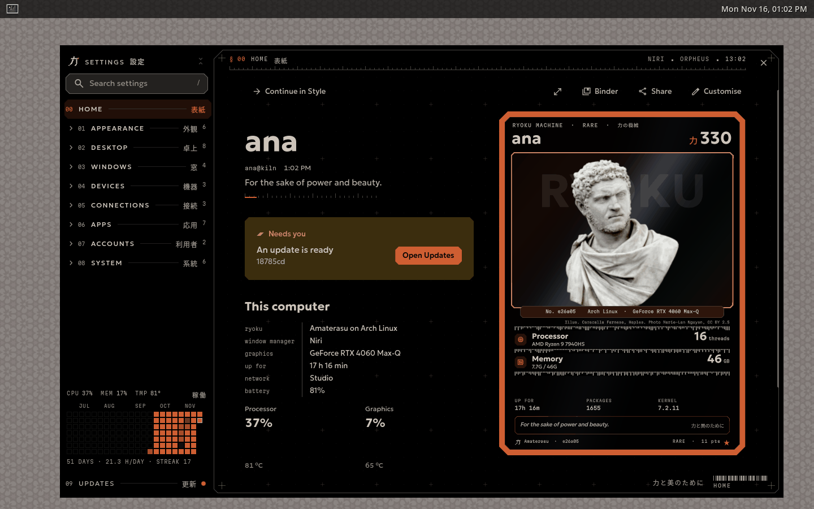

# Lithic

Lithic is the Ryoku UI language: the look and behaviour of Ryoku Settings
(the Hub, `ryoku/hub/quickshell/`), packaged as a library so every Ryoku app
can draw the same way. A page is a printed sheet on one paper, numbered,
ruled with ticks, registered at its corners and glossed in kanji, its planes
cut at 45 degrees, its actions quiet plaques with one gold, every change
applied at once with Undo. The Hub is the reference: where a page here and
the Hub disagree, the Hub is right.

The library carries the colour roles, the type roles, the cut, the spacing
run, the durations and the controls, for QML, the web, Gio and the terminal.
Colours come from the reader's choice for the whole desktop, Ryoku's own or
the wallpaper's, light or dark; the design style (Lithic, Material, Adwaita,
Fluent) is a separate choice that reshapes corners and planes only.



## Folder map

| Path | One job |
|---|---|
| `README.md` | Start here, choose a reading path and import a library. |
| [design.md](design.md) | The language: principles, vocabulary, roles, type, shape, space, do and don't. |
| [styles.md](styles.md) | The design switch and its independence from colour. |
| [palette.md](palette.md) | How Ryoku's colours or the wallpaper's fill the roles, light and dark, contrast and tint. |
| [layout.md](layout.md) | The window, the frame, the sidebar tree, the page sheet, Home, overlays, keyboard. |
| [components.md](components.md) | Every component as the Hub uses it, with geometry; parts for other app shapes. |
| [motion.md](motion.md) | Curves, durations, transitions, motion at rest, reduced motion. |
| [copy.md](copy.md) | The Hub's voice, capitals and gloss, with real strings. |
| [map.md](map.md) | From a pattern to the Hub file or library type that draws it. |
| [working.md](working.md) | Adopt the language in an app and verify it. |
| [checklist.md](checklist.md) | The review an app must pass to match the Hub. |
| [tokens.json](tokens.json) | The one source of dimensions, type, motion and palette values. |
| `library/qml/Lithic/` | The `Lithic` QML module the Hub imports: the `Lithic` singleton, `LithicTokens` and one type per component. |
| `library/qml/Lithic/qmldir` | Registers the module, its singletons and public types. |
| `library/qml/CMakeLists.txt` | Compiles the module with Geologica and Martian Mono inside the plugin. |
| `library/qml/build.sh` | Builds and installs the compiled module into a QML import directory (packages run it). |
| `library/qml/install.sh` | Copies the module's sources and faces into a dev box's import root so edits show on reload. |
| `library/qml/tests/` | The QML module's tests. |
| [library/qml/README.md](library/qml/README.md) | QML installation, imports and the public API. |
| `library/web/` | Dependency-free CSS and ES modules for browser surfaces (`lithic.css`, `lithic.js`, `palette.js`, generated `tokens.css` and `tokens.js`). |
| [library/web/README.md](library/web/README.md) | Web imports, markup and the public API. |
| `library/go/` | The Go module shared by Gio and terminal surfaces: `tokens`, `palette`, `theme`, `anim`, `kit`, `symbols`, `fonts`, `term`. |
| `library/go/fonts/` | Geologica and Martian Mono, embedded for Gio and loaded by the QML and web libraries. |
| `library/go/cmd/lithic-tokens/` | Regenerates the token files from `tokens.json`. |
| `library/go/cmd/lithic-symbols/` | Regenerates `symbols/symbols.go` from `symbols/list.txt`. |
| [library/go/README.md](library/go/README.md) | Gio and terminal imports and the public API. |
| [library/parity/README.md](library/parity/README.md) | The cross-stack palette parity check. |
| `examples/qml/`, `examples/web/`, `examples/gio/`, `examples/term/` | Runnable galleries of the library's components, one per stack, each with a README. |
| `examples/sheets/` | HTML compositions of library parts for list-and-detail apps, with their own [README](examples/sheets/README.md). They are not the Hub. |
| `media/` | Rendered PNGs. `hub-<name>-<dark or light>.png` are the Hub itself (home, page, overview, search, dialog, studio, binder); the others render the library's galleries and sheets. |

## Read order

1. [design.md](design.md): the principles and the vocabulary every other
   page uses.
2. [palette.md](palette.md) and [styles.md](styles.md): where colour and shape
   come from, and what the reader chooses.
3. [layout.md](layout.md) and [components.md](components.md) while composing
   a surface; [map.md](map.md) to find the file that draws a pattern.
4. [motion.md](motion.md) and [copy.md](copy.md).
5. [working.md](working.md) to adopt it, then [checklist.md](checklist.md)
   before calling a surface done.

The Hub's own description is [docs/hub.md](../hub.md); the desktop-wide guide
is [docs/ui-ux.md](../ui-ux.md).

## Quick start

### QML

Add `docs/lithic/library/qml` to the import path and `import Lithic`, as the
Hub does. Read roles from `Lithic`, planes from `Lithic.planes()`, and draw
shapes with `CutRect` and text with `Label { typeRole: ... }`. Run a gallery
page with:

```sh
cd docs/lithic/examples/qml
QT_FORCE_STDERR_LOGGING=1 LITHIC_PAGE=foundation LITHIC_MODE=dark qml6 -I ../../library/qml Gallery.qml
```

### Web

Include `<link rel="stylesheet" href="/library/web/lithic.css">`, then run
`import Lithic from "/library/web/lithic.js"; Lithic.init();` in a module.
Serve the directory and open a gallery page:

```sh
cd docs/lithic && python -m http.server 8000
# http://127.0.0.1:8000/examples/web/foundation.html?mode=dark
```

### Go with Gio

Import `github.com/ryoku-dev/ryoku/docs/lithic/library/go/kit` with the
`palette`, `theme` and `anim` packages the surface needs. Run a gallery page
with:

```sh
cd docs/lithic/examples/gio
go run . --page foundation --mode dark
```

### Terminal

Import `github.com/ryoku-dev/ryoku/docs/lithic/library/go/term`. Run the
terminal gallery with:

```sh
cd docs/lithic/examples/term
go run . --page controls --width 120 --mode dark
```

The galleries show the library's parts one by one. The Hub shows them
composed: render it privately as [working.md](working.md#render-the-hub-privately)
describes, and compare with the `media/hub-*.png` renders.

## Rules

- Draw in the desktop's style and colours ([styles.md](styles.md)): all four
  styles, Ryoku's colours and the wallpaper's, light and dark. Never offer a
  style or colour picker of your own.
- Read every colour from a role; values live only in `tokens.json`.
- Draw every shape with the library's cut; never set a radius.
- Make almost every action a quiet plaque and spend gold on the one
  consequential action of a view.
- Apply a change when it is made and offer Undo on a placard.
- Number what you list, rule section heads, and gate every kanji gloss on
  `UiPreferences.showJapaneseGloss`.
- Keep planes flat: no lit top edge, no left accent bar on a selected
  option, no grey on lighter grey, no blur in the chrome
  ([design.md](design.md#blur-where-it-fits)).
- Take type, space and durations from the tokens; use Geologica and Martian
  Mono only.
- Move on a cause; at rest, move only inside the Ambient gate (focused
  window, motion allowed), and never under reduced motion
  ([design.md](design.md#what-may-move-at-rest)).
- Write plain sentences in sentence case, with no em-dash
  ([copy.md](copy.md)).
- Check all four styles, both colour sources, dark and light, against
  [checklist.md](checklist.md).
