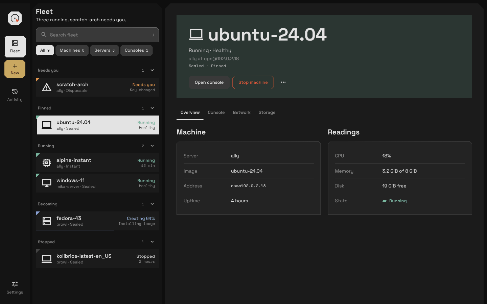

# Lithic

Lithic is Ryoku's UI language: cut, not molded. It builds calm, flat surfaces from live palette roles, 45 degree cuts, plain state words and motion that answers an action and then stops.



## Folder map

| Path | One job |
|---|---|
| `README.md` | Start here, choose a reading path and import a library. |
| [map.md](map.md) | Find the component or pattern that fits an intent. |
| [working.md](working.md) | Build a new surface or upgrade an existing one. |
| [design.md](design.md) | Define the language, principles, shape and type. |
| [palette.md](palette.md) | Resolve Ryoku palette sources into Lithic roles. |
| [components.md](components.md) | Specify component anatomy, state, interaction and accessibility. |
| [layout.md](layout.md) | Define window archetypes, size classes and geometry. |
| [motion.md](motion.md) | Define the one curve, durations and reduced motion. |
| [copy.md](copy.md) | Define claims, proofs, labels and sentence case. |
| [checklist.md](checklist.md) | Review a surface before it is complete. |
| [tokens.json](tokens.json) | Hold the one source of dimensions, type, motion and fallback palette data. |
| `library/` | Hold the reusable libraries for every supported stack. |
| `library/qml/Lithic/` | Provide the `Lithic` QML module and one QML type per component. |
| `library/qml/Lithic/qmldir` | Register the QML module, singleton and public types. |
| `library/qml/Lithic/LithicTokens.qml` | Expose the generated QML token singleton. |
| [library/qml/README.md](library/qml/README.md) | Document QML installation, imports and public API. |
| `library/web/` | Provide dependency-free CSS and ES modules for browser surfaces. |
| `library/web/tokens.css` | Expose generated non-colour CSS tokens. |
| `library/web/tokens.js` | Expose the generated token object. |
| `library/web/lithic.css` | Import the complete web stylesheet. |
| `library/web/foundation.css` | Style roles, type and cut primitives. |
| `library/web/controls.css` | Style controls. |
| `library/web/lists.css` | Style lists, containers, state and progress. |
| `library/web/overlays.css` | Style overlays, navigation and data views. |
| `library/web/lithic.js` | Initialize the web library. |
| `library/web/palette.js` | Resolve palette sources and set role properties. |
| `library/web/controls.js` | Add control behaviour. |
| `library/web/lists.js` | Add list behaviour. |
| `library/web/overlays.js` | Add overlay behaviour. |
| [library/web/README.md](library/web/README.md) | Document web imports, markup and public API. |
| `library/go/` | Provide the Go module shared by Gio and terminal surfaces. |
| `library/go/tokens/` | Expose generated Go tokens. |
| `library/go/palette/` | Resolve Ryoku palette sources using the standard library. |
| `library/go/theme/` | Turn roles and tokens into a Gio theme. |
| `library/go/anim/` | Provide motion helpers. |
| `library/go/kit/` | Provide reusable Gio components. |
| `library/go/symbols/` | Hold the Material Symbols Sharp icons for Gio, generated from `list.txt`. |
| `library/go/term/` | Provide the terminal component subset. |
| `library/go/cmd/lithic-tokens/` | Update generated token files from `tokens.json`. |
| `library/go/cmd/lithic-symbols/` | Update `symbols/symbols.go` from `symbols/list.txt`. |
| [library/go/README.md](library/go/README.md) | Document Gio and terminal imports and public API. |
| [library/parity/README.md](library/parity/README.md) | Document the cross-stack palette parity check. |
| `examples/` | Hold runnable component galleries and design sheets. |
| [examples/qml/Gallery.qml](examples/qml/Gallery.qml) | Run the QML gallery shell. |
| `examples/qml/pages/` | Hold the four QML gallery pages. |
| [examples/qml/pages/Foundation.qml](examples/qml/pages/Foundation.qml) | Show QML foundations. |
| [examples/qml/pages/Controls.qml](examples/qml/pages/Controls.qml) | Show QML controls. |
| [examples/qml/pages/Lists.qml](examples/qml/pages/Lists.qml) | Show QML lists, containers, state and progress. |
| [examples/qml/pages/Overlays.qml](examples/qml/pages/Overlays.qml) | Show QML overlays, navigation and data views. |
| [examples/qml/README.md](examples/qml/README.md) | Document QML gallery commands. |
| [examples/web/index.html](examples/web/index.html) | Link the web gallery pages. |
| [examples/web/foundation.html](examples/web/foundation.html) | Show web foundations. |
| [examples/web/controls.html](examples/web/controls.html) | Show web controls. |
| [examples/web/lists.html](examples/web/lists.html) | Show web lists, containers, state and progress. |
| [examples/web/overlays.html](examples/web/overlays.html) | Show web overlays, navigation and data views. |
| [examples/web/README.md](examples/web/README.md) | Document web gallery commands. |
| `examples/gio/` | Hold the Gio gallery module. |
| `examples/gio/go.mod` | Point the gallery at the local Go library. |
| `examples/gio/main.go` | Run or render the Gio gallery. |
| `examples/gio/page_*.go` | Show each Gio component group. |
| [examples/gio/README.md](examples/gio/README.md) | Document Gio gallery commands. |
| `examples/term/` | Hold the terminal gallery module. |
| `examples/term/go.mod` | Point the terminal gallery at the local Go library. |
| `examples/term/main.go` | Print the terminal gallery. |
| [examples/term/README.md](examples/term/README.md) | Document terminal gallery commands. |
| [examples/sheets/](examples/sheets/) | Show complete compositions of the language. |
| [media/](media/) | Hold only rendered PNGs. |

## Read order

Read [design.md](design.md), [palette.md](palette.md) and [map.md](map.md) first. Read [components.md](components.md) and [layout.md](layout.md) while composing a surface, then [motion.md](motion.md) and [copy.md](copy.md). Follow [working.md](working.md) for implementation and finish with [checklist.md](checklist.md).

## Quick start

### QML

Add `docs/lithic/library/qml` to the import path and use `import Lithic`. Run a gallery page with:

```sh
cd docs/lithic/examples/qml
QT_FORCE_STDERR_LOGGING=1 LITHIC_PAGE=foundation LITHIC_MODE=follow qml6 -I ../../library/qml Gallery.qml
```

### Web

Include `<link rel="stylesheet" href="/library/web/lithic.css">`, then run `import Lithic from "/library/web/lithic.js"; Lithic.init();` in a module. Serve the directory and open the gallery page:

```sh
cd docs/lithic && python -m http.server 8000
# http://127.0.0.1:8000/examples/web/foundation.html?mode=follow
```

### Go with Gio

Import `github.com/ryoku-dev/ryoku/docs/lithic/library/go/kit` with the `palette`, `theme` and `anim` packages needed by the surface. Run a gallery page with:

```sh
cd docs/lithic/examples/gio
go run . --page foundation --mode follow
```

### Terminal

Import `github.com/ryoku-dev/ryoku/docs/lithic/library/go/term`. Run the terminal gallery through its command:

```sh
cd docs/lithic/examples/term
go run . --page controls --width 120 --mode follow
```

## Design sheets

The [sheet index](examples/sheets/README.md) links every source sheet.

| Sheet | Render | Shows |
|---|---|---|
| [Fleet](examples/sheets/fleet.html) | [Fleet render](media/sheet-fleet.png) | A list and detail window. |
| [Now](examples/sheets/now.html) | [Now render](media/sheet-now.png) | The Now board with attention and progress. |
| [Draft](examples/sheets/draft.html) | [Draft render](media/sheet-draft.png) | A draft form with its aside. |
| [Settings](examples/sheets/settings.html) | [Settings render](media/sheet-settings.png) | A settings page with a section index. |
| [Memento](examples/sheets/memento.html) | [Memento render](media/sheet-memento.png) | A destructive confirmation flow. |
| [Tile](examples/sheets/tile.html) | [Tile render](media/sheet-tile.png) | The compact class. |
| [Becoming](examples/sheets/becoming.html) | [Becoming render](media/sheet-becoming.png) | A resource being created. |

## Rules

- Use palette roles, never colour values in a surface.
- Cut corners at 45 degrees or leave them square. Do not round them.
- Do not add shadows, gradients, glows, inset wells or status dots. Blur can
  be used where it fits and looks good, as a faint hint under a picture or on a
  scrim ([design.md](design.md#blur-where-it-fits)).
- Reserve gold for the one consequential action in a view.
- Show state with a mineral shape and a word, never colour alone.
- Take dimensions, type and motion from the tokens.
- Use sentence case.
- Move only in response to an action, and stop when the response is complete.
- Check dark, light and follow modes before calling a surface complete.
