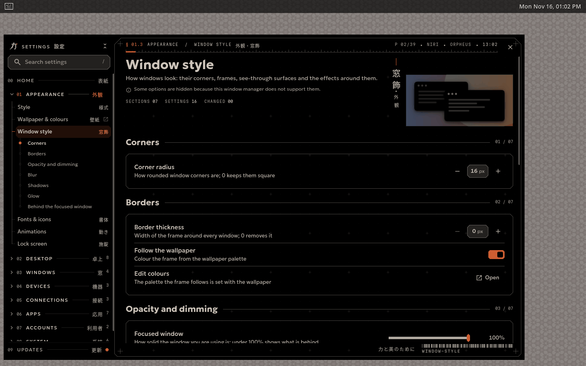
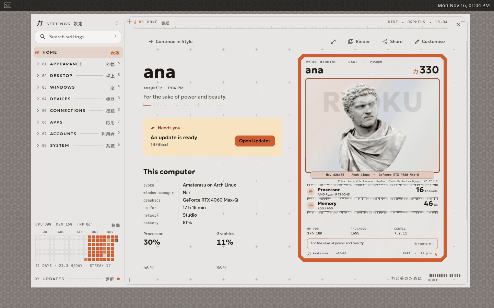

# Lithic: the Ryoku UI language

Ryoku looks and behaves the way Ryoku Settings (the Hub) does. The Hub in
`ryoku/hub/quickshell/` is the reference implementation, and every rule on
this page is written from it, with the file that shows it. The Lithic library
in `library/` is where the Hub's colours, type, cuts, space and controls come
from, packaged so another app can draw the same way.

Paths in this page are short. Hub files are under `ryoku/hub/quickshell/`
(`Hub.qml`, `components/...`, `Singletons/...`). Library files are under
`docs/lithic/library/qml/Lithic/` and are written `Lithic/<File>.qml`. The
window, its frame and the sheet parts are drawn by the Hub; the planes, roles,
type roles, cuts and controls come from the library.



Read this page first. The companion pages go deeper on one subject each:

| Page | Subject |
|---|---|
| [styles.md](styles.md) | The design switch (Lithic, Material, Adwaita, Fluent) and why it never touches colour. |
| [palette.md](palette.md) | How a palette fills the roles: Ryoku's own colours or the wallpaper's, light and dark, contrast and tint. |
| [layout.md](layout.md) | The window, the frame, the sidebar tree, the sheet of a page, Home, overlays and the keyboard. |
| [components.md](components.md) | Every component as the Hub uses it, with its geometry. |
| [motion.md](motion.md) | Curves, durations, hover and press, page transitions, motion at rest, reduced motion. |
| [copy.md](copy.md) | The Hub's voice, with its real strings. |
| [checklist.md](checklist.md) | The review an app must pass to match the Hub. |
| [map.md](map.md) | From a pattern to the file that draws it. |
| [working.md](working.md) | Adopting the language in an app, and checking it. |

## 1. Principles

1. **A printed sheet, not app chrome.** Every page is printed like an
   instrument sheet ([hub.md](../hub.md)). Under it lies the registration sheet: a
   faint dot every 24 px, a small plus on every fourth crossing, and a
   registration mark (a cross) in each corner
   (`components/sheet/RegSheet.qml:4-44`). A mono masthead runs over the page
   and a colophon closes its foot (`Hub.qml:929-982`).

2. **A numbered index.** Everything has a number, the way ryoku.dev numbers
   its sections (`registry/numbering.js:4-5`). Home is `00`, the categories
   are `01` to `08` with Updates `09` at the foot, a page is `01.3`, a
   section is `01 / 08`, and the masthead gives the page's place among all
   pages, `P 02/39`. The spec strip under a title counts what the page holds:
   `SECTIONS 08 · SETTINGS 16 · CHANGED 03`
   (`components/SettingsPage.qml:729-772`; `components/sheet/Masthead.qml:36-47`).

3. **Tick rulers.** A ruler of 1 px ticks every 8 px, every fifth one taller,
   runs under the masthead and carries the scroll marker
   (`components/sheet/Masthead.qml:123-158`). Home's motto sits on a
   `TickRuler` with the same rhythm (`components/TickRuler.qml`). Section
   heads are ruled by a hairline from the title to the section ordinal
   (`Lithic/Section.qml:47-54`), and the system card's data code is written
   in three tick rulers.

4. **Registration.** Things are registered, not boxed: plates carry 10 px
   corner ticks (`components/sheet/Plate.qml`), the sheet carries its corner
   crosses, and the sidebar and the page are one paper set apart by a 1 px
   hairline (`Hub.qml:910-924`; `Singletons/Tone.qml:7-10`).

5. **Kanji gloss, behind one switch.** Every category and page has a real
   Japanese word: "Latin names the thing, the kanji is its seal; every gloss
   is the real word, never decoration" (`registry/registry.js:188-206`). Every
   gloss shows only while `UiPreferences.showJapaneseGloss` is on
   ([Kanji gloss](#kanji-gloss)).

6. **Dithered plates.** Classical sculpture photographs, regraded to grey,
   are set as a live 1-bit ordered dither in the ink: one plate per category,
   each with its licence credit (`shaders/plate.frag`; `registry/plates.js`).
   Home's figure is a sculpture too. Shine is restrained: the card foil is
   smooth, never dotted, and capped at 0.6 alpha (`shaders/foil.frag`).

7. **Cuts and plaques are the watermark.** Every plane is a `CutRect` with
   45 degree chamfers (`Lithic/CutRect.qml`); the page pane cuts 16 at its top
   and 7 at its foot (`Hub.qml:912-924`). Buttons are plaques
   (`Lithic/Plaque.qml`), and a plaque's tier is its fill recipe
   (`Lithic/PlaqueRecipe.qml`). Lithic draws no rounded corner; the few round
   marks are listed in [section 5](#5-shape-the-cut-scale).

8. **Quiet first, one gold.** Almost every action is a quiet plaque (206 of
   the Hub's tier uses); the one consequential action of a view is gold:
   "one gold on the plate: the first thing that waits"
   (`components/Home.qml:838-841`).

9. **A change applies when it is made.** There is no Save and no action bar
   ([hub.md](../hub.md)). Every change raises a placard with Undo
   (`Hub.qml:1104-1158`).

10. **Ambient life, only while you look.** At rest the masthead clock ticks
    seconds, live figures sample, a scan crosses the plates every 11 s and
    Home's dust drifts. All of it runs only while Settings is the focused
    window and motion is not reduced; otherwise nothing moves
    (`Hub.qml:405-410`; `Singletons/Ambient.qml:7-9`;
    [What may move at rest](#what-may-move-at-rest)).

11. **Copy is the product's voice.** Plain sentences addressed to you, in
    sentence case, with no em-dash and no exclamation mark ([copy.md](copy.md)).

## 2. Vocabulary

These are the names every Lithic page uses. Use them in code, comments and
reviews.

### The sheet

| Word | What it is | Drawn by |
|---|---|---|
| **sheet** | A page as the Hub prints it: registration sheet, masthead, page head, sections, colophon, folio. | `components/SettingsPage.qml`, `Hub.qml:901-1002` |
| **registration sheet** | The faint dot grid with plus marks under every page. | `components/sheet/RegSheet.qml` |
| **registration marks** | The 13 px crosses 14 px in from each corner of the sheet, and the 10 px corner ticks that register a plate. | `RegSheet.qml:39-44`, `Plate.qml` |
| **masthead** (also **header strip**) | The 34 px mono line over the page: `§ 01.3`, the place in spaced capitals (`APPEARANCE / WINDOW STYLE`), its gloss, then facts at the right (`P 02/39 · NIRI · ORPHEUS · 12:40:07`). | `components/sheet/Masthead.qml` |
| **tick ruler** | A row of 1 px ticks every 8 px, every fifth taller, on a baseline. | `Masthead.qml:123-145`, `components/TickRuler.qml` |
| **scroll marker** | The 24 x 3 accent mark riding the masthead ruler at the reading position. | `Masthead.qml:147-158` |
| **colophon** | The foot line: the motto 力と美のために and the page id as a Code 39 barcode. | `components/sheet/Colophon.qml`, `components/about/CardBarcode.qml` |
| **folio** | The page's number set huge and faint across the foot of a page that fits, with its kanji. | `components/sheet/Folio.qml` |
| **plate** | A category's dithered sculpture, 1.6:1, with corner ticks and a credit. It develops in from the top. | `components/sheet/Plate.qml`, `registry/plates.js` |
| **scan** | The band of light that crosses the plates every 11 s while Ambient is on. | `Singletons/Ambient.qml`, `Plate.qml:62-63` |
| **gloss** | The kanji word for a category or page, set beside or after its Latin name. | `registry/registry.js:191-210` |
| **Tategaki** | The gloss set vertically beside a page's plate or preview: an accent rule, the page kanji, a dot, the category kanji. | `components/sheet/Tategaki.qml` |
| **seal** | A kanji used as a mark, not a gloss: 力 before the card's power, the role kanji in a badge hanko. Seals are not gated. | `components/about/TradingCard.qml:272-281`, `components/badge/Emblem.qml` |
| **numbered index** | The numbers on everything: `00`, `01`, `01.3`, `P 02/39`, `01 / 08`. | `registry/numbering.js` |
| **section ordinal** | The `01 / 08` at the end of a section head's rule. | `SettingsPage.qml:770-772` |
| **spec strip** | The zero-padded counts under a page title: label in mono capitals, value in mono, lit in the accent when it matters. | `components/PageHeader.qml:115-139` |
| **motto** | "For the sake of power and beauty." and its gloss 力と美のために, on Home and in the colophon. | `components/Home.qml:741-755`, `Colophon.qml` |
| **carved word** | The huge word in capitals cut into the paper behind Home's figure. | `components/Home.qml:461-485` |

### The frame and the sidebar

| Word | What it is | Drawn by |
|---|---|---|
| **paper** | The one tone the sidebar, the page and a slab lie on in Lithic. | `Lithic.planes()`, `Singletons/Tone.qml:16-22` |
| **plane** | Any surface with a role and a cut: side, pane, card (slab), overlay. | `Tone.qml` |
| **page pane** | The cut plane that holds the page, 16 at the top and 7 at the foot, drawn by its hairline. | `Hub.qml:912-924` |
| **stage** | The clipped region between the masthead and the colophon where a page draws. | `Hub.qml:954-974` |
| **sidebar tree** | The always-shown 272 px project tree: Home, numbered folders, leaves, the open page's outline, Activity, Updates. | `components/nav/` |
| **folder** | A category line: chevron, numeral, name in spaced capitals, leader, gloss, page count. | `components/nav/NavRow.qml`, `NavFolder.qml` |
| **leaf** | A page line under its folder, indented 22, mixed case. | `NavFolder.qml:124-141` |
| **guide** | The 1 px line down a folder's leaves; lit while it holds the open page. | `NavFolder.qml:75-86` |
| **branch tick** | The 8 x 1 tick from the guide to a leaf; accent on the selected leaf. | `NavRow.qml:83-92` |
| **leader** | The 1 px line from a numbered name to its gloss or count. | `NavRow.qml:168-179` |
| **selection mark** | The one cut wash (`Tone.select`) that travels to the open line. | `components/nav/NavTree.qml:188-235` |
| **section outline** | The open page's sections hung under its leaf, on a thread. | `components/nav/NavOutline.qml` |
| **section nodes** | The small circles on the outline thread; the section being read grows and takes the accent. | `NavOutline.qml:77-89` |
| **peek** | The card that appears beside the sidebar after resting 480 ms on a line, with a one-sentence summary. The Hub's hover explanation. | `components/nav/HubSidebar.qml:180-257` |
| **Activity map** | The sidebar's live CPU, memory and temperature line over a 7-row contribution graph of uptime. | `components/sheet/Activity.qml` |
| **Updates foot** | The `09 UPDATES 更新` line at the sidebar's foot. | `HubSidebar.qml:155-178` |
| **Updates dot** | The 8 px accent circle on the Updates foot when an update is ready. | `NavRow.qml:228-243` |
| **drawer** | The sidebar under a scrim when the window is forced below 880 px. | `Hub.qml:1024-1048` |

### The page

| Word | What it is | Drawn by |
|---|---|---|
| **page head** | Title, lead, state line, note, spec strip, and at the right a live preview or the plate, plus Tategaki. | `components/PageHeader.qml` |
| **section** | A ruled head (`section` title, hairline, section ordinal) over its content. | `Lithic/Section.qml` |
| **slab** | The cut plane that holds a section's rows: the paper in Lithic, drawn by a vein hairline, cut 7, inset 21. | `Lithic/Slab.qml` |
| **toned slab** | A slab on a mineral field; Home's "Needs you" is the one in the Hub. | `components/Home.qml:798-815` |
| **setting row** | Title and detail beside a short right-aligned control, top-aligned beside a taller single control, or above a full-width group or list with a 13 px gap; rows are 13 apart with a hairline between. | `Lithic/SettingRow.qml` |
| **Changed tag** | The word "Changed" beside a row title whose value differs from its default. | `SettingRow.qml:169-224` |
| **reset plaque** | The quiet small plaque before a side-by-side control or at a stacked title's far end when its value is changed. | `SettingRow.qml` |
| **More options** | The disclosure at a slab's foot; its rows are built on first open. | `SettingsPage.qml:826-852` |
| **Related** | The closing section of tonal plaques to nearby pages. | `SettingsPage.qml:876-898` |
| **datasheet** | Home's two-column table of facts, keys in mono, split by one vein rule. | `components/Home.qml:909-946` |
| **reading** | A live figure on Home: name, tabular value, engraved chart, proof line. | `components/Home.qml:947-992` |

### Actions, notices and state

| Word | What it is | Drawn by |
|---|---|---|
| **plaque** | A button: a cut slab you can press. A press deepens its cut by 4 and sinks its content 1 px. | `Lithic/Plaque.qml` |
| **tier** | A plaque's fill recipe: `quiet`, `line`, `gold`, `tonal`, `danger`, `dangerLine`, `on`. | `Lithic/PlaqueRecipe.qml` |
| **small plaque** | The 32 px plaque; nearly every plaque in the Hub is small. | `Plaque.qml` |
| **icon button** | The Hub's 34 x 34 cut-6 glyph button (close, menu, info). | `components/IconButton.qml` |
| **placard** | The notice every change raises: an accent plane with the message and an Undo plaque, draining over 5 s. | `Lithic/Placard.qml`, `Hub.qml:1104-1158` |
| **confirm** | The Hub's protected question: a dialog with Cancel and the verb, optionally a typed name or a countdown. | `Hub.qml:381-399`, `Lithic/Confirm.qml` |
| **info button** | An icon button that opens a popover with an explanation. | `components/about/CardOnlineSwitch.qml:25-82` |
| **claim and proof** | A state word and the fact under it: "Up to date" over "Ryoku %1, %2". | `Lithic/Claim.qml`, `Home.qml:769-786` |
| **mineral** | A state's colour: jade alive, lapis becoming, amber needs you, jasper failed. | `Lithic.qml` |
| **flake** | The small slanted state token; three of them make `Working`. | `Lithic/Flake.qml`, `Lithic/Working.qml` |
| **blade** | A bar with a cut leading edge: progress (`BladeProgress`), a meter (`BladeMeter`), the placard's drain, the scroll thumb. | `Lithic/BladeProgress.qml`, `Lithic/ScrollRail.qml` |
| **engraved chart** | A 1.5 px line over a 45 degree hatch on a vein baseline. | `Lithic/EngravedChart.qml` |

### Cards and badges

| Word | What it is | Drawn by |
|---|---|---|
| **system card** | The 630 x 880 trading card of this machine, with its rarity. | `components/about/TradingCard.qml` |
| **rarity** | The six-tier ladder from Common to Secret rare. | `registry/rarity.js` |
| **binder** | The overlay that holds friends' traded cards. | `components/about/Binder.qml` |
| **card studio** | The 1280-wide dialog that edits the card and Home. | `components/about/CardEditor.qml` |
| **emblem** | A badge seal: tick rim, arc text, diamond, hanko. | `components/badge/Emblem.qml` |
| **certificate** | The badge's signed page, on a hexgrid atmosphere. | `components/badge/Certificate.qml` |
| **foil** | The smooth, capped sheen on a card. | `shaders/foil.frag` |

### Motion

| Word | What it is | Drawn by |
|---|---|---|
| **Ambient** | The gate for life at rest: on only while Settings is focused and motion is allowed. | `Singletons/Ambient.qml` |
| **rise** | A page's entrance: a fade with a 14 px slide from the right. | `Hub.qml:1004-1022` |
| **Reveal** | Sections rising in turn as a page opens, the first five only. | `components/Reveal.qml`, `SettingsPage.qml:773-783` |
| **chisel** | The library's curve, `[0.2, 0, 0, 1]`. | `LithicTokens.qml` |
| **Chase** | The frame-rate-independent pointer follow; never overshoots. | `components/Chase.qml` |

## 3. Materials: roles, not colours

Nothing in a Lithic surface names a colour. Every surface reads a **role**
from `Lithic` (`Lithic.qml:15-40`): `ground`, `stone1` to `stone4`, `slab`,
`field`, `vein`, `edge`, `fg`, `fg2`, `fg3`, `sel`, `onSel`, `onSel2`, `gold`,
`onGold`, `goldInk`, `jade`, `lapis`, `amber`, `jasper`, `scrim`, `container`,
`containerInk`. The values live only in [tokens.json](tokens.json); the full
recipe is [palette.md](palette.md).

**Where the colours come from.** The reader chooses once, for the whole
desktop, in Settings › Style (`theme.colours` in `shell.json`):

- **Ryoku colours** (the default): the ryoku.dev palette, black paper with
  bone ink in dark and a warm grey paper in light, with the sun orange as the
  accent. Choosing Ryoku colours replaces the wallpaper scheme completely;
  nothing of the wallpaper lingers (`Lithic.qml:557-570, 662-667`). On Arch
  the action colour (`gold`) is the same orange as the accent (`sel`); on
  Fedora, NixOS and Void the edition's accent takes `gold` only.
- **Wallpaper colours**: the wallpaper's Matugen palette. In the Lithic
  style it only dyes: every lightness stays on Lithic's ladder and only hue
  and a capped chroma come from Matugen, so contrast never drops. In the
  other styles the Matugen roles are used as they are
  (`Lithic.qml:543-618, 671-700`; [palette.md](palette.md)).
- **Light and dark** follow the desktop's mode (Dark, Light, Automatic or
  Sun). **Contrast** (standard or high) picks the high ladders. **Tint**
  (off, low, medium) lets the Lithic paper take more of the wallpaper's hue
  and shows only when the colours follow the wallpaper.
- **The design style is separate.** `theme.design` changes corners and plane
  layering only, never colour; switching it never resets the colours
  ([styles.md](styles.md)).

**What each role does in the Hub:**

| Role | In the Hub |
|---|---|
| `ground` | the paper: the window, the sidebar, and in Lithic the page too |
| `stone2`, `slab` | the page pane and the section slab; the same paper in Lithic |
| `stone4` | dialogs and popovers |
| `field` | tracks, fields, tonal plaques |
| `vein` | every hairline: pane, slab, row separators, section rules, chart baselines |
| `edge` | the scroll thumb at rest, plate corner ticks, the certificate stroke |
| `fg`, `fg2`, `fg3` | ink, strong to faint; `fg2` is the working ink (142 uses), `fg3` the faint (83), `fg` is kept for titles, values and the selected or hovered |
| `sel` (accent) | a mark of place only: the masthead `§` numeral, the selected line's numeral, mark and gloss, its branch tick, the scroll marker, the section node being read, the Tategaki rule, lit spec facts, the Updates dot; and the fill of placards, toggles on, segment selection, slider handles |
| `container` | the selection mark's wash in the tree (`Tone.select`) |
| `gold`, `onGold`, `goldInk` | the action: the gold plaque fill, the line plaque's ink and hairline; also Home's motto tick and carved word, and card and binder rarity marks |
| `jade`, `lapis`, `amber`, `jasper` | states: alive, becoming, needs you, failed; `jasper` is also every error line |
| `scrim` | under dialogs and the drawer |

Jade, lapis and amber are fixed per mode and never follow a palette, so a
state reads the same on every wallpaper. Badge role inks are fixed too
(`components/badge/Emblem.qml:21-27`).

**Planes by style** (`Lithic.planes()`, consumed as `Tone.side`,
`Tone.pane`, `Tone.card`): in Lithic the sidebar, the page and a slab are
one paper drawn by vein hairlines; Material, Adwaita and Fluent lift the
page and its slabs a tone ([palette.md](palette.md)). Never pick a plane
tone by hand.

**Washes the Hub derives** (each an alpha of `fg`, dark / light;
`Singletons/Tone.qml:23-32`):

| Wash | Alpha | Used for |
|---|---|---|
| `line` | 0.08 / 0.10 | the hairline above the sidebar foot |
| `guide` | 0.16 / 0.20 | the tree guide, branch ticks, leaders |
| `guideLit` | 0.36 / 0.42 | the guide of the folder that holds the open page |
| `hover` | 0.06 / 0.07 | the row hover plane |
| `press` | 0.10 / 0.12 | the row press plane |

Disabled controls draw at `Lithic.disabledOpacity` (0.5). Focus is a 2 px
`fg2` ring 2 px outside the cut; the Hub's own rows and icon buttons draw a
1 px `fg2` stroke on their cut instead.

### Blur, where it fits

The Hub's chrome draws no blur. Its planes are solid and its scrims are flat
alphas of a role (`Lithic.scrim`, `ground`). Two soft effects exist, both on
content, not chrome: the drop shadow under the badge seal on the system card
(`components/about/TradingCard.qml:371-387`) and the window-shadow preview on
the Window style page, which shows a desktop setting
(`components/previews/MiniWindow.qml:44`). A surface that matches the Hub
keeps its planes, controls, type and states free of blur.

## 4. Type

Two faces, bundled by the library (`Lithic.qml:91-97`):

- **Geologica** (`font.sans`) for everything a person reads: titles, rows,
  details, sentences, plaques.
- **Martian Mono** (`font.mono`) for data, numbering and running heads: the
  masthead, tree numerals, the spec strip, section ordinals, datasheet keys,
  plate credits, Activity figures.

Icons are Material Symbols Sharp, installed system-wide. Kanji come from the
system's CJK fallback; the badge asks for Noto Sans CJK JP Black by name.
No other family appears in live Hub code.

Every `Label` is plain text with native rendering and a fixed line height;
`numeric: true` turns on tabular figures (`Lithic/Label.qml:5-24`). The roles
(`LithicTokens.qml:310-389`), in px:

| Role | Face | Size / line | Weight | Where the Hub uses it |
|---|---|---|---|---|
| `name` | sans | 52 / 56 | Bold | Home's name, the one monument |
| `sentence` | sans | 34 / 40 | Bold | page titles at 32 / 40 (`PageHeader.qml:55-63`), dialog titles, Home's name below 640 px |
| `section` | sans | 21 / 28 | Bold | section titles, Home's "This computer", reading values |
| `title` | sans | 15 / 20 | Medium | Tategaki and folio kanji (at their own sizes) |
| `row` | sans | 15 / 20 | Medium | setting-row titles, search hits, page rows |
| `proof` | sans | 15 / 21 | Regular | Home's motto, card flavour |
| `body` | sans | 14 / 20 | Regular | the page lead in `fg2`, dialog text, placard message |
| `label` | sans | 13 / 16 | Medium | plaque text, search group heads, slider values |
| `detail` | sans | 13 / 18 | Regular | the most used role: row details in `fg2`, state lines, notes in `fg3`, errors in `jasper`, crumbs, tree leaves |
| `caption` | sans | 12 / 16 | Regular | note lines, outline section names, kanji glosses |
| `group` | sans | 12 / 16 | Medium | folder names and the sidebar title, in spaced capitals |
| `mono` | mono | 10 / 16 | Regular | `user@host`; the folio numeral at 168 Light |
| `monoSm` | mono | 9 / 15 | Regular | masthead, tree numerals, spec strip, section ordinals, credits, Activity |

**Spaced capitals.** The Hub sets a few running lines in capitals with
tracking. The text is written in sentence case and the capitals are a font
setting (`font.capitalization: Font.AllUppercase`), so translations stay
whole:

| Line | Tracking | Source |
|---|---|---|
| tree folder names | 1.4 | `components/nav/NavRow.qml:164-165` |
| sidebar title "SETTINGS" | 1.6 | `components/nav/HubSidebar.qml:52-53` |
| masthead place | 1.4 | `components/sheet/Masthead.qml:66-68` |
| masthead facts | 1.2 | `Masthead.qml:117` |
| spec-strip labels | 1.2 | `components/PageHeader.qml:129-130` |
| Activity summary | 0.6 | `components/sheet/Activity.qml:274-276` |
| card head "RYOKU MACHINE" | 1.6 | `components/about/TradingCard.qml:243-244` |
| Style preview "EXAMPLE" chip | 1.2 | `pages/Style.qml:99-100` |
| Home's carved word | none | `components/Home.qml:481` |

Everything else is mixed case: page titles, leaves, row titles, details,
sentences, plaques.

**Weight marks selection.** The selected leaf, a folder name and the section
being read are DemiBold (`NavRow.qml:163`; `NavOutline.qml:100`).

**Numerals.** Indexing and counting the sheet is mono and zero-padded: `00`
to `09`, `01.3`, `P 02/39`, `01 / 08`, `SECTIONS 08`, `51 DAYS · 21.3 H/DAY ·
STREAK 17`. Live figures are sans with tabular figures: Home's clock and
readings, slider values. The folio numeral is mono 168 Light, tracking -6, at
a few percent of `fg`.

### Kanji gloss

Every gloss is the real word from `registry/registry.js:191-210` and shows
only while `UiPreferences.showJapaneseGloss` is on (`ryoku/ui`; it defaults
to on and follows `shell.json` live). Where the Hub sets it:

| Where | Size and ink |
|---|---|
| tree line, after the name | caption 12 (folders) or 11 (leaves), tracking 1; `fg3` at rest, `fg2` on hover, accent when selected or open |
| sidebar title | 設定 after "Settings" |
| masthead | category・page, caption 11, tracking 1, `fg3` |
| page head (Tategaki) | page kanji at 20 / 22 in `fg2`, a dot, category kanji 11 in `fg3`, under an 18 px accent rule |
| folio | the page kanji at 96 beside the number |
| colophon | 力と美のために, caption 11, tracking 2, `fg3` |
| Activity map | 稼働, caption 11, tracking 2 |
| Home | the motto's gloss, only when there is no custom tagline |
| system card and binder | the card head's 力の機械, the flavour line, 収集 |

Seals are not glosses and stay when glosses are off: 力 before the card's
power, 力 on the empty binder's card, the role kanji in a badge hanko.

## 5. Shape: the cut scale

A cut is a 45 degree chamfer measured along one edge. `CutRect` draws the
eight-point outline of a rectangle `(x0, y0, x1, y1)` with cut `c`:

```
(x0+c, y0) (x1-c, y0) (x1, y0+c) (x1, y1-c) (x1-c, y1) (x0+c, y1) (x0, y1-c) (x0, y0+c)
```

Each corner may take its own cut. A surface writes cuts only, never a
radius: the library turns the cut into each style's corner
(`Lithic.qml:48-69`; [styles.md](styles.md#the-four-styles)):

| Style | Corner |
|---|---|
| Lithic | the cut |
| Material | radius = cut x 2.6, at most 28; a pill at 56 px tall or less |
| Adwaita | cut x 1.6, at most 14; a pill at 26 or less |
| Fluent | cut x 0.75, at most 8; a pill at 22 or less |

**The cut scale** (`LithicTokens.qml:15-28`) and where the Hub spends it:

| Cut | px | In the Hub |
|---|---|---|
| `token` | 3 | small tokens |
| `toggleTrack` / `tooltip` | 4 | the toggle track |
| `toggleKnob` | 2 | the toggle knob |
| `segment` | 5 | the selected segment, 4 inside a 7 track |
| `small` | 6 | tree rows, the selection mark, outline rows, icon buttons, search hits, page rows, small plaques |
| `mid` | 7 | plaques, fields, slabs, the peek card, the page pane's foot |
| `menu` / `overlay` / `placard` | 8 | popovers, menus, placards |
| `notch` | 12 | none; the library's [notch](components.md#notch) serves other app shapes |
| `large` | 16 | the page pane's top corners, dialogs, the binder panel |

Cards keep their own cuts: the system card 22 outside and 14 on its face, the
holo window 8, the certificate 32, its verification plaque 10.

**Press.** A plaque's cut deepens by 4 and its content sinks 1 px over 90 ms
(`Lithic/Plaque.qml:63-93`; `Lithic.pressCutGrow`).

**Hairlines** are 1 px, drawn inside the outline. When a cut outline is
stroked, the inner cut shrinks by `width x (2 - √2)` so the stroke stays even
around the chamfer (`Lithic/CutRect.qml:37`). A cut nested inside another is
concentric by the same correction: the segment sits 4 inside a 7 track and
cuts 5.

**Where hairlines go:** the pane, every plain slab, between setting rows
(centred in their 13 px gap, none above the first), section rules, the
datasheet's column rule, chart baselines. Thicker strokes appear only on
cards.

**A quiet plaque draws no edge or fill at rest**, so its words line up with
the column; its cut appears with its hover fill (`components/Home.qml:993-996`).

**What is still round.** The section nodes on the outline (5 px circles,
7 px for the section being read) and the 8 px Updates dot
(`NavOutline.qml:77-89`; `NavRow.qml:228-236`). Masthead separators are 3 x 3
squares.

**Hexagons.** The Hub's boxes are chamfered: octagons when four corners are
cut, a hexagon-like outline when two are (the page pane). The only literal
hexagon is the faint `hexgrid` atmosphere behind the badge certificate
(`shaders/design-atmosphere.frag`; `components/badge/Certificate.qml:56-62`).

## 6. Space

The spacing run is `4, 8, 13, 21, 34, 55` (`s1` to `s6`,
`LithicTokens.qml:301-308`). The middle steps carry the Hub:

| Step | px | In the Hub |
|---|---|---|
| `s1` | 4 | the segment inset |
| `s2` | 8 | plaques in a dialog, stacked placards, the column inside a section |
| `s3` | 13 | between setting rows; section title to its content |
| `s4` | 21 | slab inset; below a section; control to row text; Home's narrow margin |
| `s5` | 34 | dialog padding; between Home's groups; the blank at a page's end |
| `s6` | 55 | Home's side margin when roomy |

The frame itself places the masthead, stage and colophon with fixed offsets
(28, 8, 10, 22, 6) outside the run (`Hub.qml:914-982`); those are the frame's,
not a surface's.

## 7. Layout, briefly

- **A desktop window**, 1280 x 800 and never smaller, not phone-shaped
  (`ShellBody.qml:33-37`).
- **The frame**: the sidebar tree at 272 px on the paper; the page pane beside
  it, 8 from the top, right and foot, cut 16 at the top and 7 at the foot; the
  masthead over the stage, the colophon under it, the close icon button at the
  pane's top right (`Hub.qml:901-1002`).
- **A settings page**: a centred column of `min(usable, 960)`, the page head,
  ruled sections with slabs of setting rows, More options, Related, 34 of
  blank at the end. No section index on the page: sections hang under the
  page's leaf in the sidebar (`components/SettingsPage.qml`).
- **Home**: the sheet flush to the pane; who you are, what waits, This
  computer, Recently changed, beside the figure or the system card
  (`components/Home.qml`).

  

- **Overlays**: dialogs on the scrim, the binder and the card viewer on their
  own shades, placards at the foot.

[layout.md](layout.md) has every number: [the frame](layout.md#the-frame),
[the sidebar tree](layout.md#the-sidebar-tree),
[the page sheet](layout.md#the-page-sheet) and [Home](layout.md#the-cover).

## 8. Components, briefly

Every component is a cut plane with one role, one ink and the shared hover,
press and focus recipes. [components.md](components.md) specifies each one as
the Hub uses it; parts the library keeps for other app shapes (rail,
tablets, tabs, tooltips and the list-and-detail frame) are in
[Parts for other app shapes](components.md#parts-for-other-app-shapes).

| Component | Role and ink | Cut | Height |
|---|---|---|---|
| plaque, `quiet` | no fill or edge, `fg2` ink; cut shows on hover | 7 (small 6) | 40 (small 32) |
| plaque, `line` | `goldInk` ink and hairline | 7 / 6 | 40 / 32 |
| plaque, `gold` | `gold` fill, `onGold` ink | 7 / 6 | 40 / 32 |
| plaque, `tonal` | `field` fill, `fg` ink | 7 / 6 | 40 / 32 |
| plaque, `danger` / `dangerLine` | `jasper` fill / `jasper` ink and hairline | 7 / 6 | 40 / 32 |
| plaque, `on` | `sel` fill, `onSel` ink; only the placard's Undo | 6 | 32 |
| icon button | wash on hover, `fg2` glyph | 6 | 34 |
| setting row | `row` title, `detail` in `fg2`; short control at most 320 wide, groups and lists stacked at full width | none | at least 44 |
| toggle | track and knob; on is `sel` | 4, knob 2 | 22 x 40 |
| segmented (also the Hub's tabs) | `field` track with vein, `sel` segment | 7, segment 5 | 36 |
| slider | 6 px track, `sel` handle 8 x 20, value in `label` | | 32 |
| stepper, picker, text field | `field` with an `edge` hairline | 7 | 44 (text field) |
| search | `field`, hint "/" | 7 | 36 in the sidebar |
| slab | the paper, vein hairline, 21 inset | 7 | content |
| dialog | `stone4`, vein hairline, 520 wide, 34 padding, on `scrim` | 16 | content |
| popover | `stone4`, vein hairline, at most 360 wide | 8 | content |
| placard | `sel` plane, `onSel` text, Undo, 2 px drain blade | 8 | 48 |
| peek | paper, vein hairline, a hard offset shadow | 7 | content |
| engraved chart | 1.5 px `fg` line over a hatch at 0.3, vein baseline | none | 44 on Home |
| Working / BladeProgress | three flakes / a blade with Cancel | | |

## 9. Motion, briefly

- **Curves.** `Easing.OutCubic` is the Hub's working curve (46 uses). The
  library's components (dialog, placard, plaque colour behaviours) and the
  Hub's `Reveal` and scroll jumps use chisel. OutBack with overshoot is used
  twice: the folder chevron (1.6) and
  the section node's growth (2). There are no springs; pointer follow uses
  `Chase`, which never overshoots and looks the same at 60 Hz and 165 Hz
  (`components/Chase.qml`).
- **Durations.** The Hub's own (`Singletons/Tone.qml:39-43`): quick 120, move
  240, unfold 260, stagger 18. The library's tokens: press 90, hover 160 in
  and 100 out, navigate 200, dialog 300 in and 160 out, placard 300 in with a
  5000 life, highlight 1600, count-up 640.
- **What moves on a cause:** row hover washes and a 2 px lean; plaque presses;
  the close glyph turning 90 degrees on hover; the selection mark travelling;
  folders unfolding with leaves 18 ms apart; a page rising with a 14 px slide;
  sections revealing 40 ms apart; the folio rolling; a plate developing; the
  Updates dot pulsing three times and resting.
- **Reduced motion** (`shell.json theme.motion.reduce`) makes every duration
  0; Reveal, the folio roll, the plate develop and the Activity print are
  instant, and Ambient is off.

[motion.md](motion.md) has every value.

### What may move at rest

Only the Ambient set, and only while Settings is the focused window and
motion is not reduced (`Hub.qml:405-410`; `Singletons/Ambient.qml`):

| At rest | Rate |
|---|---|
| the masthead seconds and Home's clock | a 1 s timer |
| the scan across the plates | every 11 s, 2.2 s long, stepped at 30 fps |
| Home's dust motes | about 15 fps, while Home shows and the plate is roomy |
| live figures (Activity, Home readings) | while visible; Home every 3 s focused, 15 s unfocused |

Between scans nothing moves, so an idle window draws no frames. Unfocused or
with reduced motion, there are no timers and the clock drops its seconds.
Cards are still at rest: every card effect needs the pointer. One exception
exists: the badge emblem turns its rim at rest while the card studio's Badge
tab is open (`components/about/BadgeTab.qml:63`).

## 10. Copy, briefly

Plain sentences addressed to you, sentence case, no em-dash, no exclamation
mark. Errors say what happened and what to do next. Running heads and folder
names show in spaced capitals by font setting, never by typing capitals.
[copy.md](copy.md) has the Hub's real strings.

## 11. Do and don't

Do:

- Read every colour from a role; let the reader's colours (Ryoku's or the
  wallpaper's), light or dark, contrast and tint fill it.
- Take planes from `Lithic.planes()` and draw every shape with `CutRect`, so
  the design style can reshape it.
- Make almost every action a quiet small plaque and spend gold on the one
  consequential action of a view. Set `kind` on every plaque: the library's
  default tier is gold (`Lithic/PlaqueRecipe.qml:4`).
- Apply a change when it is made and raise a placard with Undo; ask through
  a confirm only for what cannot simply be undone.
- Number what you list, in mono and zero-padded, and rule section heads.
- Gate every kanji gloss on `UiPreferences.showJapaneseGloss`, and use the
  real word.
- Use the accent only to mark where the reader is.
- Explain on rest with a peek or on demand with an info button.
- Gate life at rest on focus and motion allowed, and stop between beats.
- Present an overview's live data with engraved charts (Home's readings, the
  Activity map).

Don't:

- Round a corner, set a radius, or draw a pill; the library does that for the
  round styles.
- Light the top edge of a plaque or a plane, or mark a selected option with a
  vertical bar on its left: the Hub marks it with the selection mark's wash
  and the accent numeral and gloss.
- Pair a grey plane with a lighter grey one in Lithic: the sidebar, the page
  and a slab are one paper set apart by hairlines.
- Add a shadow to a plane, plaque, slab or dialog. The Hub's only shadows are
  the peek's hard offset and the card seal's.
- Dither the shine: the foil is smooth and capped; only the plates and Home's
  light are dithered.
- Add a tooltip, a Save button or an action bar.
- Show a gloss that ignores the switch, or one that is decoration rather
  than the word.
- Write capitals into a string; set them with the font.
- Put a colour value in a surface, or offer a colour or style picker of your
  own.
- Animate at rest outside the Ambient gate, or loop without end.
- Use the old logo: the mark is the cut 力 of
  `ryoku/assets/brand/logo-mark-v2.png`, drawn by `components/RyokuMark.qml`.

## 12. Adopting it in an app

1. Import the library (`import Lithic`, or the web, Gio or terminal stack in
   [README.md](README.md#quick-start)) and read roles, type roles, cuts,
   space and durations from it. The Hub uses no `Ryoku.Ui` visual component
   and no `Tokens`; only non-visual singletons such as `I18n` and
   `UiPreferences`.
2. Follow the desktop: `theme.design`, `theme.colours`, contrast, tint and
   light or dark come from `shell.json` and reload live
   ([styles.md](styles.md)).
3. Build the window as a desktop window. Where the app has pages of settings,
   follow the Hub's sheet: masthead, numbered index, page head with spec
   strip, ruled sections, slabs of setting rows, colophon
   ([layout.md](layout.md)). These sheet parts are drawn by the Hub today
   (`components/sheet/`, `components/nav/`), not by the library; copy them
   from there until the library carries them.
4. Wire reduced motion and the Ambient gate before adding any life at rest
   ([motion.md](motion.md)).
5. Write every string through `I18n.tr` in the Hub's voice
   ([copy.md](copy.md)).
6. Review against [checklist.md](checklist.md); [working.md](working.md) has
   the steps and how to render a surface privately.
