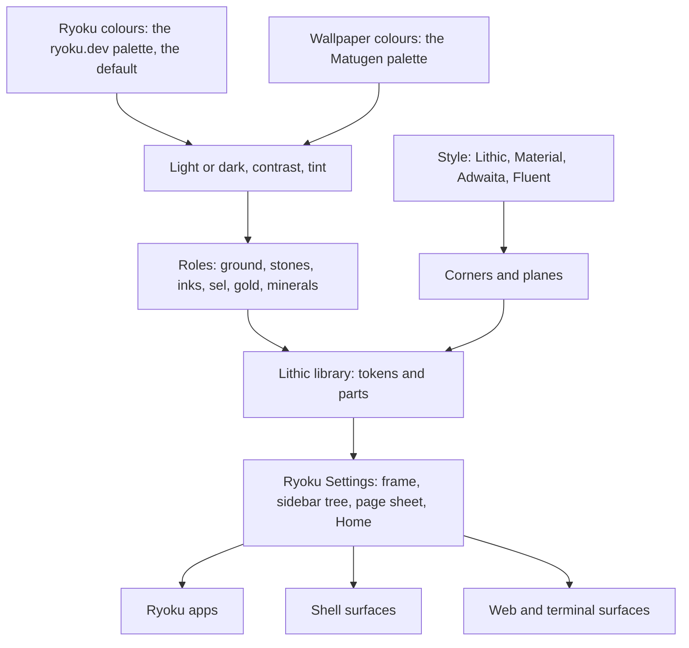

# Map

Use this page to find the part that fits an intent, and where it lives: the
Hub component that draws it in Ryoku Settings, the Lithic library type, and
its web, Gio and terminal counterparts where they exist. Ryoku Settings (the
Hub, `ryoku/hub/quickshell/`) is the reference; [components.md](components.md)
and [layout.md](layout.md) give every part's geometry.

## The system

Colours and style are separate choices. Choosing Ryoku's colours replaces the
wallpaper's scheme completely; choosing a style changes corners and planes
and never the colours ([styles.md](styles.md), [palette.md](palette.md)).

## Hub patterns

The parts the Hub draws itself, and the patterns it composes from the
library. Hub paths are relative to `ryoku/hub/quickshell/`; `-` means no
stack has a counterpart.

| Pattern | What it is for | Spec | Hub component | Lithic type | Web, Gio, terminal |
|---|---|---|---|---|---|
| Frame | the window: sidebar tree beside one page pane on one paper | [The frame](layout.md#the-frame) | `Hub.qml`, `ShellBody.qml` | `CutRect`, `Lithic.planes()` | - |
| Registration sheet | the dots, plus marks and registration marks under every page | [The registration sheet](layout.md#the-registration-sheet) | `components/sheet/RegSheet.qml` | - | - |
| Masthead | the mono line over the page: number, place, gloss, facts, tick ruler and scroll marker | [The masthead](layout.md#the-masthead) | `components/sheet/Masthead.qml` | `Label` | - |
| Colophon | the motto and the page's barcode at the sheet's foot | [The colophon](layout.md#the-colophon) | `components/sheet/Colophon.qml`, `components/about/CardBarcode.qml` | `Label` | - |
| Folio | a short page's number, huge and faint, in its empty foot | [The folio](layout.md#the-folio) | `components/sheet/Folio.qml` | `Label` | - |
| Plate | a category's dithered sculpture beside the page head | [The page sheet](layout.md#the-page-sheet) | `components/sheet/Plate.qml`, `registry/plates.js`, `shaders/plate.frag` | - | - |
| Tategaki | the page's kanji set vertically beside the plate or preview | [The page sheet](layout.md#the-page-sheet) | `components/sheet/Tategaki.qml` | `Label` | - |
| Tick ruler | ticks 8 apart, every fifth tall, a first segment in the lead ink | [The cover](layout.md#the-cover) | `components/TickRuler.qml` | - | - |
| Sidebar tree | all of Settings as numbered folders and leaves | [The sidebar tree](layout.md#the-sidebar-tree) | `components/nav/HubSidebar.qml`, `NavTree.qml`, `NavFolder.qml`, `NavRow.qml` | `Search`, `ScrollRail`, `CutRect` | - |
| Section outline | the open page's sections under its leaf, with section nodes | [The sidebar tree](layout.md#the-sidebar-tree) | `components/nav/NavOutline.qml` | - | - |
| Activity map | the machine now and a contribution map of the hours it was on | [Charts on overview screens](components.md#charts-on-overview-screens) | `components/sheet/Activity.qml`, `Singletons/LiveStats.qml` | - | - |
| Peek | a page's live summary beside its tree line | [The sidebar tree](layout.md#the-sidebar-tree) | `components/nav/HubSidebar.qml`, `registry/summaries.js` | `CutRect`, `Glyph`, `Label` | - |
| Page sheet | one settings page: head, ruled sections, slabs, rows | [The page sheet](layout.md#the-page-sheet) | `components/SettingsPage.qml` | `Section`, `Slab`, `SettingRow`, `Disclosure`, `ScrollRail` | Go `kit.Section`, `kit.Slab`, `kit.SettingRow` |
| Page head | title, page actions, lead, state, note, spec strip, preview or plate | [The page sheet](layout.md#the-page-sheet) | `components/PageHeader.qml` | `Label`, `Plaque` | - |
| Setting row control | the control a row's schema asks for | [Setting row](components.md#setting-row) | `components/RowControl.qml` | `Toggle`, `Segmented`, `Slider`, `Stepper`, `Picker`, `TextField`, `ColorField`, `ChordField`, `PathField`, `Plaque` | see the component index |
| Search and results | find any page, section or setting | [Search](components.md#search) | `components/SearchResults.qml`, `components/SearchDoor.qml`, `components/PageRow.qml`, `Hub.qml:538-704` | `Search` | web `.l-search`, Go `kit.Search`, terminal `term.RenderSearch` |
| Notices with Undo | announce every change and offer to take it back | [Notices with Undo](components.md#notices-with-undo) | `Hub.qml:1104-1158`, `Singletons/Changes.qml` | `Placard` | web `.l-placard`, Go `kit.Placard`, terminal `term.RenderPlacard` |
| Confirm | ask before a consequential or timed change | [Dialogs and confirms](components.md#dialogs-and-confirms) | `Hub.qml:381-399, 1055-1102` | `Confirm`, `Dialog` | web `.l-confirm`, Go `kit.Confirm`, terminal `term.RenderConfirm` |
| Info button | explain a row in a popover | [Popovers, menus and info buttons](components.md#popovers-menus-and-info-buttons) | `components/IconButton.qml`, `components/about/CardOnlineSwitch.qml` | `Popover`, `CutRect` | web `.l-popover`, Go `kit.Popover` |
| IconButton | the window's close, the drawer, collapse and info buttons | [IconButton](components.md#iconbutton) | `components/IconButton.qml` | `CutRect`, `Glyph` | - |
| Long work | nothing for a second, then Working, then progress with Cancel | [Empty, waiting and error states](components.md#empty-waiting-and-error-states) | `components/backup-import/WorkLine.qml`, `components/add-ons/TaskLine.qml` | `Working`, `BladeProgress` | web `.l-working`, Go `kit.Working`, terminal `term.RenderWorking` |
| The cover | Home: who the reader is, what waits, this computer | [The cover](layout.md#the-cover) | `components/Home.qml` | `Slab`, `Claim`, `EngravedChart`, `Plaque` | - |
| Readings | how this computer moves, as engraved charts | [Charts on overview screens](components.md#charts-on-overview-screens) | `components/Home.qml:947-992`, `Singletons/LiveStats.qml` | `EngravedChart` | web `.l-engraved-chart`, Go `kit.EngravedChart` |
| System card | the reader's machine as a trading card | [System card](components.md#system-card) | `components/about/TradingCard.qml`, `CardShare.qml`, `registry/rarity.js` | `CutRect`, `Label` | - |
| Binder | friends' cards, compared | [Binder](components.md#binder) | `components/about/Binder.qml`, `BinderCard.qml`, `BinderCompare.qml`, `CardViewer.qml` | `Plaque`, `CutRect` | - |
| Card studio | customise the card and Home | [Card studio](components.md#card-studio) | `components/about/CardEditor.qml`, `BadgeTab.qml` | `Dialog`, `Segmented`, `Slab`, `SettingRow` | - |
| Badge seal | a team badge's two-ink seal | [Emblem](components.md#emblem) | `components/badge/Emblem.qml` | - | - |
| Certificate | the badge's signed certificate | [Certificate](components.md#certificate) | `components/badge/Certificate.qml` | `CutRect` | - |
| Ryoku mark | the current Ryoku logo, the cut 力 | [The sidebar tree](layout.md#the-sidebar-tree) | `components/RyokuMark.qml` (`ryoku/assets/brand/logo-mark-v2.png`) | - | - |
| Motion helpers | groups rising in turn; pointer follow without overshoot | [motion.md](motion.md) | `components/Reveal.qml`, `components/Chase.qml`, `Singletons/Ambient.qml`, `Singletons/Tone.qml` | `ChiselColorBehavior`, `ChiselNumberBehavior` | - |

## Component index

The QML names are types from `import Lithic` (`docs/lithic/library/qml/Lithic/qmldir`).
Web names are classes in `docs/lithic/library/web/`, with state carried by ARIA
and `data-*` attributes. Go names are in package `kit` of
`docs/lithic/library/go`. Terminal names are pure render functions in package
`term`; interactive ones also expose a Bubble Tea model such as
`term.TextFieldModel`. `-` means that stack has no form of it. The last column
names one Hub file that uses the part.

Icons are Material Symbols Sharp in every stack. QML and the web set the
font's ligatures. Gio draws them from package `symbols`, generated from
`symbols/list.txt` by `go run ./cmd/lithic-symbols` in `library/go` (`-check`
reports a stale `symbols.go`); add a name to the list to use a new icon.

### Foundation

| Component | What it is for | Spec | QML type | Web class | Go name in `kit` | Terminal render function | In the Hub |
|---|---|---|---|---|---|---|---|
| Icon | Show a semantic glyph beside an accessible name. | [Icon](components.md#icon) | `Glyph` | `l-glyph` | `kit.Icon` | `-` | `components/nav/NavRow.qml` |
| CutRect | Draw a filled or stroked plane with independent 45 degree corner cuts. | [CutRect](components.md#cutrect) | `CutRect` | `l-cut` | `kit.FillCut`, `kit.StrokeCut` | `-` | `Hub.qml` |
| FocusRing | Show keyboard focus outside a cut part. | [FocusRing](components.md#focusring) | `FocusRing` | `l-focus-ring` | `kit.FocusRing` | `-` | `components/PageRow.qml` |
| Hatch | Engrave a static 45 degree field. | [Hatch](components.md#hatch) | `Hatch` | `l-hatch` | `kit.Hatch` | `-` | `components/displays/ArrangeCanvas.qml` |
| Flake | Show a state mineral or a fraction of becoming. | [Flake](components.md#flake) | `Flake` | `l-flake` | `kit.Flake` | `term.RenderFlake` | `components/updates/RunView.qml` |

### Plaques and controls

| Component | What it is for | Spec | QML type | Web class | Go name in `kit` | Terminal render function | In the Hub |
|---|---|---|---|---|---|---|---|
| Plaque | Run one labelled action, in its tier. | [Plaque tiers](components.md#plaque-tiers) | `Plaque` | `l-plaque` | `kit.Plaque` | `term.RenderPlaque` | `components/SettingsPage.qml` |
| IconPlaque | Run a compact action whose glyph has an accessible name. | [IconPlaque](components.md#iconplaque) | `IconPlaque` | `l-icon-plaque` | `kit.IconPlaque` | `-` | `components/FolderChooser.qml` |
| SettingRow | Lay out one setting with its words, control, Changed tag and reset plaque. | [Setting row](components.md#setting-row) | `SettingRow` | `l-setting-row` | `kit.SettingRow` | `-` | `components/SettingsPage.qml` |
| Toggle | Switch one setting on or off. | [Toggle](components.md#toggle) | `Toggle` | `l-toggle` | `kit.Toggle` | `term.RenderToggle` | `components/RowControl.qml` |
| Segmented | Pick one of two to five options shown at once, or switch tabs. | [Segmented](components.md#segmented) | `Segmented` | `l-segmented` | `kit.Segmented` | `-` | `components/about/CardEditor.qml` |
| Slider | Change a bounded quantity by feel. | [Slider](components.md#slider) | `Slider` | `l-slider` | `kit.Slider` | `-` | `components/RowControl.qml` |
| Stepper | Change a bounded number in exact steps. | [Stepper](components.md#stepper) | `Stepper` | `l-stepper` | `kit.Stepper` | `term.RenderStepper` | `pages/Displays.qml` |
| Picker | Choose one value from many. | [Picker](components.md#picker) | `Picker` | `l-picker` | `kit.Picker` | `term.RenderPicker` | `components/RowControl.qml` |
| TextField | Enter or edit text, with label, help, error and secret states. | [TextField](components.md#textfield) | `TextField` | `l-text-field` | `kit.TextField` | `term.RenderTextField` | `components/RowControl.qml` |
| ChordField | Record and show one keyboard shortcut as keycaps. | [ChordField](components.md#chordfield) | `ChordField` | `l-chord-field` | `kit.ChordField` | `-` | `components/shortcuts/BindRow.qml` |
| ColorField | Choose one colour from roles or as hex. | [ColorField](components.md#colorfield) | `ColorField` | `l-color-field` | `kit.ColorField` | `-` | `components/RowControl.qml` |
| PathField | Choose a file or folder, or type its path. | [PathField](components.md#pathfield) | `PathField` | `l-path-field` | `kit.PathField` | `-` | `components/RowControl.qml` |
| Disclosure | Reveal optional settings in place. | [Disclosure](components.md#disclosure) | `Disclosure` | `l-disclosure` | `kit.Disclosure` | `term.RenderDisclosure` | `components/SettingsPage.qml` |
| ListEditor | Add, edit, remove and reorder the items of a list in place. | [ListEditor](components.md#listeditor) | `ListEditor` | `l-list-editor` | `kit.ListEditor` | `-` | `components/launcher/AppListEditor.qml` |
| DesignTile | Show one look with its preview, state and action. | [Design tiles](components.md#design-tiles) | `DesignTile` | `l-design-tile` | `kit.DesignTile` | `-` | `pages/LockScreen.qml` |
| DesignGallery | Lay out design tiles in a grid navigated by keyboard. | [Design tiles](components.md#design-tiles) | `DesignGallery` | `l-design-gallery` | `kit.DesignGallery` | `-` | `components/bar/StyleGallery.qml` |

### Rows, containers and state

| Component | What it is for | Spec | QML type | Web class | Go name in `kit` | Terminal render function | In the Hub |
|---|---|---|---|---|---|---|---|
| Slab | Group a section's rows on one cut plane; toned for what needs the reader. | [Slab](components.md#slab) | `Slab` | `l-slab` | `kit.Slab` | `term.RenderSlab` | `components/SettingsPage.qml` |
| Section | Title a group, ruled with its section ordinal on a page sheet. | [Section](components.md#section) | `Section` | `l-section` | `kit.Section` | `term.RenderSection` | `components/SettingsPage.qml` |
| Facts | Show label and value rows. | [Facts](components.md#facts) | `Facts` | `l-facts` | `kit.Facts` | `term.RenderFacts` | `pages/Keyboard.qml` |
| RowList | Navigate and select a scrolling list. | [RowList](components.md#rowlist) | `RowList` | `l-row-list` | `kit.RowList` | `term.RenderRowList` | `components/keyboard/LayoutChooser.qml` |
| Tablet | Show one resource row with identity, claim, proof and one action. | [Tablet](components.md#tablet) | `Tablet` | `l-tablet` | `kit.Tablet` | `term.RenderTablet` | `components/launcher/AppListEditor.qml` |
| Claim | Pair a state flake with its plain state word. | [Claim, Marks and Sentence](components.md#claim-marks-and-sentence) | `Claim` | `l-claim` | `kit.Claim` | `term.RenderClaim` | `components/Home.qml` |
| Marks | List short traits without competing with state. | [Claim, Marks and Sentence](components.md#claim-marks-and-sentence) | `Marks` | `l-marks` | `kit.Marks` | `term.RenderMarks` | `components/users/PersonSlab.qml` |
| Sentence | Compose one readable sentence from spans. | [Claim, Marks and Sentence](components.md#claim-marks-and-sentence) | `Sentence` | `l-sentence` | `kit.Sentence` | `term.RenderSentence` | `pages/Updates.qml` |
| ScrollRail | Show and drag the scroll position of a scrolling pane. | [ScrollRail](components.md#scrollrail) | `ScrollRail` | `l-scroll` | `kit.ScrollRail` | `-` | `components/SettingsPage.qml` |
| Empty | Explain an empty result and name the next step. | [Empty, waiting and error states](components.md#empty-waiting-and-error-states) | `Empty` | `l-empty` | `kit.Empty` | `term.RenderEmpty` | `pages/LockScreen.qml` |

### Progress, overlays and data

| Component | What it is for | Spec | QML type | Web class | Go name in `kit` | Terminal render function | In the Hub |
|---|---|---|---|---|---|---|---|
| Working | Show activity when no fraction is known. | [Empty, waiting and error states](components.md#empty-waiting-and-error-states) | `Working` | `l-working` | `kit.Working` | `term.RenderWorking` | `components/backup-import/WorkLine.qml` |
| BladeProgress | Show job progress, determinate or not. | [Empty, waiting and error states](components.md#empty-waiting-and-error-states) | `BladeProgress` | `l-blade-progress` | `kit.BladeProgress` | `term.RenderBladeProgress` | `components/add-ons/TaskLine.qml` |
| BladeMeter | Show a measured fraction such as storage. | [Charts on overview screens](components.md#charts-on-overview-screens) | `BladeMeter` | `l-blade-meter` | `kit.BladeMeter` | `term.RenderBladeMeter` | `components/users/PersonSlab.qml` |
| EngravedChart | Show how a reading moved, as a line over hatch. | [Charts on overview screens](components.md#charts-on-overview-screens) | `EngravedChart` | `l-engraved-chart` | `kit.EngravedChart` | `-` | `components/Home.qml` |
| Placard | Announce a change, with Undo. | [Notices with Undo](components.md#notices-with-undo) | `Placard` | `l-placard` | `kit.Placard` | `term.RenderPlacard` | `Hub.qml` |
| Dialog | Hold a decision, a chooser or an editor over the window. | [Dialogs and confirms](components.md#dialogs-and-confirms) | `Dialog` | `l-dialog` | `kit.Dialog` | `term.RenderDialog` | `components/about/CardEditor.qml` |
| Confirm | Require explicit confirmation, optionally by typed name or with a countdown. | [Dialogs and confirms](components.md#dialogs-and-confirms) | `Confirm` | `l-confirm` | `kit.Confirm` | `term.RenderConfirm` | `Hub.qml` |
| Popover | Place an anchored overlay and keep it inside the window. | [Popovers, menus and info buttons](components.md#popovers-menus-and-info-buttons) | `Popover` | `l-popover` | `kit.Popover` | `-` | `components/about/CardOnlineSwitch.qml` |
| Menu | Present a short list of actions or choices. | [Popovers, menus and info buttons](components.md#popovers-menus-and-info-buttons) | `Menu` | `l-menu` | `kit.Menu` | `term.RenderMenu` | `components/app-rules/ChooserPopover.qml` |
| Search | Narrow a collection with a clearable query. | [Search](components.md#search) | `Search` | `l-search` | `kit.Search` | `term.RenderSearch` | `components/nav/HubSidebar.qml` |

### Parts for other app shapes

The Hub does not use these. Rashin, Ryotunes and Ryoport do, for window shapes
the Hub does not have.

| Component | What it is for | Spec | QML type | Web class | Go name in `kit` | Terminal render function | Used by |
|---|---|---|---|---|---|---|---|
| Notch | Mark one state or pending change at a corner. | [Notch](components.md#notch) | `Notch` | `l-notch` | `kit.Notch` | `term.RenderNotch` | Rashin |
| Blade | Draw a bar with a 45 degree leading edge. | [Blade](components.md#blade) | `Blade` | `l-blade` | `kit.Blade` | `term.RenderBlade` | Ryotunes |
| Tabs | Switch among a few views of one resource. | [Tabs](components.md#tabs) | `Tabs` | `l-tabs` | `kit.Tabs` | `term.RenderTabs` | Rashin, Ryotunes |
| Filters | Narrow a list with exclusive chips and live counts. | [Filters](components.md#filters) | `Filters` | `l-filters` | `kit.Filters` | `term.RenderFilters` | Rashin, Ryotunes |
| GroupHeader | Name and count a group of rows. | [GroupHeader](components.md#groupheader) | `GroupHeader` | `l-group-header` | `kit.GroupHeader` | `term.RenderGroupHeader` | Rashin, Ryotunes |
| Skeleton | Hold a list's shape while it loads. | [Skeleton](components.md#skeleton) | `Skeleton` | `l-skeleton` | `kit.Skeleton` | `-` | Rashin, Ryotunes |
| Tooltip | Name an unlabelled control under the pointer. | [Tooltip](components.md#tooltip) | `Tooltip` | `l-tooltip` | `kit.Tooltip` | `-` | Ryoport |
| SectionIndex | Follow and navigate a settings page's sections beside the column. | [SectionIndex](components.md#sectionindex) | `SectionIndex` | `l-section-index` | `kit.SectionIndex` | `-` | Rashin, Ryotunes |
| Aside | Preview what a draft will make or write. | [Aside and DraftColumns](components.md#aside-and-draftcolumns) | `Aside` | `l-aside` | `kit.Aside` | `term.RenderAside` | Rashin |
| DraftColumns | Keep a draft form and its aside together. | [Aside and DraftColumns](components.md#aside-and-draftcolumns) | `DraftColumns` | `l-draft-columns` | `kit.DraftColumns` | `term.RenderDraftColumns` | Rashin |
| AppFrame | Arrange a list and detail window. | [The list and detail frame](components.md#the-list-and-detail-frame) | `AppFrame` | `l-app-frame` | `kit.AppFrame` | `-` | Ryoport |
| Rail | Navigate a list and detail window's destinations. | [The list and detail frame](components.md#the-list-and-detail-frame) | `Rail` | `l-rail` | `kit.Rail` | `-` | Ryoport |
| NewPlaque | Open the New menu from the rail. | [The list and detail frame](components.md#the-list-and-detail-frame) | `NewPlaque` | `l-new-plaque` | `kit.NewPlaque` | `-` | Ryoport |
| Pane | Separate the rail, list and work planes. | [The list and detail frame](components.md#the-list-and-detail-frame) | `Pane` | `l-pane` | `kit.Pane` | `-` | Ryoport |
| Header | Head a selected resource. | [The list and detail frame](components.md#the-list-and-detail-frame) | `Header` | `l-header` | `kit.Header` | `-` | Ryoport |
| MineralField | Tone a resource's header by its state. | [The list and detail frame](components.md#the-list-and-detail-frame) | `MineralField` | `l-mineral-field` | `kit.MineralField` | `term.RenderMineralField` | Ryoport |
| SplitPlaque | Pair a main action with a menu of alternatives. | [The list and detail frame](components.md#the-list-and-detail-frame) | `SplitPlaque` | `l-split-plaque` | `kit.SplitPlaque` | `term.RenderSplitPlaque` | Ryoport |
| BecomingName | Fill a resource's name as it is made. | [The list and detail frame](components.md#the-list-and-detail-frame) | `BecomingName` | `l-becoming-name` | `kit.BecomingName` | `-` | Ryoport |

The library's `BrandMark` is not the Ryoku logo; Ryoku's mark is the cut 力
the Hub draws as `components/RyokuMark.qml`.

## Choosing a part

| Intent | Choose |
|---|---|
| The one consequential action in a view | A `gold` [plaque](components.md#plaque-tiers). |
| Everything else you can do | `quiet` plaques; a `line` plaque for the action beside the gold one. |
| A destructive action | A [confirm](components.md#dialogs-and-confirms) with a `danger` action that names the verb. |
| A change the reader may want back | Apply it at once and announce it with a [placard](components.md#notices-with-undo) with Undo. |
| A state | A [claim](components.md#claim-marks-and-sentence): a flake and a plain word, with its proof beside it. |
| One setting | A [setting row](components.md#setting-row) on a section's slab. |
| On or off | A [toggle](components.md#toggle). |
| Two to five options worth seeing at once, or tabs | A [segmented](components.md#segmented) control. |
| One of many values | A [picker](components.md#picker). |
| A bounded number by feel, or exactly | A [slider](components.md#slider), or a [stepper](components.md#stepper). |
| Settings most people never change | "More options", a [disclosure](components.md#disclosure) at the slab's foot. |
| A list the reader edits | A [list editor](components.md#listeditor). |
| Why a setting does what it does | An [info button](components.md#popovers-menus-and-info-buttons) beside its control. |
| What a page holds, under the pointer | The sidebar tree's [peek](layout.md#the-sidebar-tree); the Hub has no tooltips. |
| Work under way | Nothing for a second, then [Working](components.md#empty-waiting-and-error-states), then a blade with Cancel past 10 s. |
| How something moved over time | An [engraved chart](components.md#charts-on-overview-screens) under its name and value. |
| Nothing to show | A claim line, a `missing` note, or [Empty](components.md#empty-waiting-and-error-states) with the next step. |
| A new settings page | The [page sheet](layout.md#the-page-sheet): `SettingsPage` with a schema, or the same head and ruled sections drawn by hand. |

## Window shapes

[Layout](layout.md) owns each shape's geometry. Renders are of the real Hub.

| Shape | Build it from | Geometry | Picture |
|---|---|---|---|
| A settings window | The frame: the sidebar tree beside one page pane on the paper, the registration sheet, masthead and colophon, overlays above. | [The frame](layout.md#the-frame) | [Page](media/hub-page-dark.png) |
| A settings page | `SettingsPage`: the page head with its spec strip and plate, ruled `Section`s with their ordinals, `Slab`s of `SettingRow`s, "More options", Related. | [The page sheet](layout.md#the-page-sheet) | [Page](media/hub-page-dark.png), [light](media/hub-page-light.png) |
| A cover | Home: the figure or system card beside one column of name, motto and tick ruler, what waits, the datasheet and readings, recent changes. | [The cover](layout.md#the-cover) | [Home](media/hub-home-dark.png), [readings](media/hub-overview-dark.png) |
| A decision | `Confirm` over the scrim: quiet Cancel and one danger or gold action that names the verb. | [Overlays and the Escape stack](layout.md#overlays-and-the-escape-stack) | [Dialog](media/hub-dialog-dark.png) |
| An editor over the window | A `Dialog` with `Segmented` tabs and one gold Done; every change applies at once. | [Card studio](components.md#card-studio) | [Studio](media/hub-studio-dark.png) |
| A collection | The binder: a cut-16 panel over a shade, a header with its actions, a grid ordered by what matters. | [Binder](components.md#binder) | [Binder](media/hub-binder-dark.png) |
| A list and detail window | Ryoport's shape: rail, list pane, work pane. | [The list and detail window](layout.md#the-list-and-detail-window) | - |
| A player window | Ryotunes's shape: top bar, sidebar, content, side panel, player bar. | [The player window](layout.md#the-player-window) | - |
| A conversation window | Rashin's shape: sidebar, one reading column and its composer. | [The conversation window](layout.md#the-conversation-window) | - |
