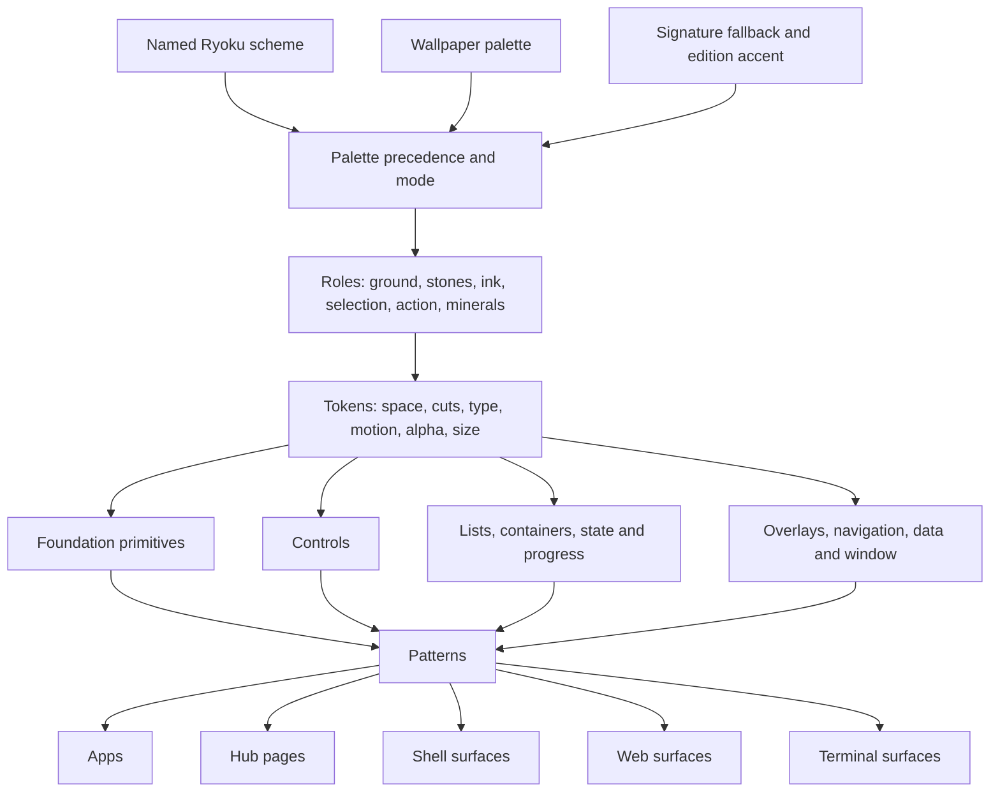

# Map

Use this page to follow the system from palette input to a finished surface, then choose the smallest component or pattern that fits the intent.

## The system

The named scheme is first, a wallpaper palette is second when wallpaper following is active, and the signature fallback is last. Forced dark or light keeps signature neutrals and takes accents from the active palette. [Palette](palette.md) defines the full resolution rule.

## Component index

The QML names are types from `import Lithic`. Web names are classes, with state carried by ARIA and `data-*` attributes. Go names are exported types or functions in package `kit`. Terminal names are pure render functions in package `term`; `-` means that stack has no terminal form. A terminal render function takes the corresponding data type when the component has data, and interactive components also expose a Bubble Tea model such as `term.TextFieldModel` or `term.MenuModel`. Reference paths are relative to Ryoport.

Icons are Material Symbols Sharp in every stack. QML and the web set the font's ligatures. Gio draws them from package `symbols`, IconVG data generated from `symbols/list.txt` by `go run ./cmd/lithic-symbols` in `library/go` (`-check` reports a stale `symbols.go`); add a name to the list to use a new icon.

### Foundation

| Component | What it is for | Spec | QML type | Web class | Go name in `kit` | Terminal render function | Ryoport reference file |
|---|---|---|---|---|---|---|---|
| Icon | Show a semantic glyph beside an accessible name. | [Icon](components.md#icon) | `Glyph` | `l-glyph` | `kit.Icon` | `-` | `ui/kit/text.go` |
| CutRect | Draw a filled or stroked plane with independent 45 degree corner cuts. | [CutRect](components.md#cutrect) | `CutRect` | `l-cut` | `kit.FillCut`, `kit.StrokeCut` | `-` | `ui/kit/draw.go` |
| Notch | Mark one state or pending change at a corner. | [Notch](components.md#notch) | `Notch` | `l-notch` | `kit.Notch` | `term.RenderNotch` | `ui/kit/token.go` |
| Blade | Draw a bar with a 45 degree leading edge. | [Blade](components.md#blade) | `Blade` | `l-blade` | `kit.Blade` | `term.RenderBlade` | `ui/kit/blade.go` |
| PlaceBlade | Mark a selected row, chip or segment with its `onSel` blade. | [PlaceBlade](components.md#placeblade) | `PlaceBlade` | `l-place-row`, `l-place-chip` | `kit.PlaceBlade` | `-` | `-` |
| Flake | Show a state mineral or a fraction of becoming. | [Flake](components.md#flake) | `Flake` | `l-flake` | `kit.Flake` | `term.RenderFlake` | `ui/kit/token.go` |
| Hatch | Engrave a static 45 degree field. | [Hatch](components.md#hatch) | `Hatch` | `l-hatch` | `kit.Hatch` | `-` | `ui/kit/chart.go` |
| FocusRing | Show keyboard focus outside a cut control. | [FocusRing](components.md#focusring) | `FocusRing` | `l-focus-ring` | `kit.FocusRing` | `-` | `ui/kit/focus.go` |

### Controls

| Component | What it is for | Spec | QML type | Web class | Go name in `kit` | Terminal render function | Ryoport reference file |
|---|---|---|---|---|---|---|---|
| Plaque | Run one labelled action with gold, line, tonal, quiet, selected or danger treatment. | [Plaque](components.md#plaque) | `Plaque` | `l-plaque` | `kit.Plaque` | `term.RenderPlaque` | `ui/kit/button.go` |
| SplitPlaque | Pair a main action with a menu of alternatives. | [SplitPlaque](components.md#splitplaque) | `SplitPlaque` | `l-split-plaque` | `kit.SplitPlaque` | `term.RenderSplitPlaque` | `ui/kit/splitbutton.go` |
| IconPlaque | Run a compact action whose glyph has an accessible description. | [IconPlaque](components.md#iconplaque) | `IconPlaque` | `l-icon-plaque` | `kit.IconPlaque` | `-` | `ui/kit/iconbutton.go` |
| TextField | Enter or edit text, with label, help, error and secret states. | [TextField](components.md#textfield) | `TextField` | `l-text-field` | `kit.TextField` | `term.RenderTextField` | `ui/kit/textfield.go` |
| Search | Narrow a collection with a clearable query. | [Search](components.md#search) | `Search` | `l-search` | `kit.Search` | `term.RenderSearch` | `ui/kit/search.go` |
| Toggle | Switch one setting on or off. | [Toggle](components.md#toggle) | `Toggle` | `l-toggle` | `kit.Toggle` | `term.RenderToggle` | `ui/kit/toggle.go` |
| Slider | Change a bounded quantity by feel. | [Slider](components.md#slider) | `Slider` | `l-slider` | `kit.Slider` | `-` | `ui/kit/slider.go` |
| Stepper | Change a bounded number in exact steps. | [Stepper](components.md#stepper) | `Stepper` | `l-stepper` | `kit.Stepper` | `term.RenderStepper` | `ui/kit/stepper.go` |
| Filters | Narrow a list with exclusive chips and live counts. | [Filters](components.md#filters) | `Filters` | `l-filters` | `kit.Filters` | `term.RenderFilters` | `ui/kit/filters.go` |
| Segmented | Pick one of two to five options shown at once. | [Segmented](components.md#segmented) | `Segmented` | `l-segmented` | `kit.Segmented` | `-` | `-` |
| Tabs | Switch among a few views of the same resource. | [Tabs](components.md#tabs) | `Tabs` | `l-tabs` | `kit.Tabs` | `term.RenderTabs` | `ui/kit/tabs.go` |
| Disclosure | Reveal optional or advanced content in place. | [Disclosure](components.md#disclosure) | `Disclosure` | `l-disclosure` | `kit.Disclosure` | `term.RenderDisclosure` | `ui/kit/disclosure.go` |

### Lists, containers, state and progress

| Component | What it is for | Spec | QML type | Web class | Go name in `kit` | Terminal render function | Ryoport reference file |
|---|---|---|---|---|---|---|---|
| Tablet | Show one resource row with identity, claim, proof and one row action. | [Tablet](components.md#tablet) | `Tablet` | `l-tablet` | `kit.Tablet` | `term.RenderTablet` | `ui/kit/row.go` |
| RowList | Navigate and select a scrolling set of tablets. | [RowList](components.md#rowlist) | `RowList` | `l-row-list` | `kit.RowList` | `term.RenderRowList` | `ui/kit/rowlist.go` |
| GroupHeader | Name and count a meaningful group of rows. | [GroupHeader](components.md#groupheader) | `GroupHeader` | `l-group-header` | `kit.GroupHeader` | `term.RenderGroupHeader` | `ui/kit/groupheader.go` |
| Skeleton | Hold list geometry while data is loading. | [Skeleton](components.md#skeleton) | `Skeleton` | `l-skeleton` | `kit.Skeleton` | `-` | `ui/kit/skeleton.go` |
| Empty | Explain an empty result and name the next step. | [Empty](components.md#empty) | `Empty` | `l-empty` | `kit.Empty` | `term.RenderEmpty` | `ui/kit/empty.go` |
| Pane | Separate rail, list and work planes on the ground. | [Pane](components.md#pane) | `Pane` | `l-pane` | `kit.Pane` | `-` | `ui/pages/common/pane.go` |
| MineralField | Give a selected resource a field toned by its state. | [MineralField](components.md#mineralfield) | `MineralField` | `l-mineral-field` | `kit.MineralField` | `term.RenderMineralField` | `ui/kit/field.go` |
| Header | Compose a resource mark, name, proof, note, marks and actions. | [Header](components.md#header) | `Header` | `l-header` | `kit.Header` | `-` | `ui/pages/common/header.go` |
| Slab | Group related settings or form fields on one cut plane. | [Slab](components.md#slab) | `Slab` | `l-slab` | `kit.Slab` | `term.RenderSlab` | `ui/pages/common/section.go` |
| Section | Give a slab or content group a readable title and spacing. | [Section](components.md#section) | `Section` | `l-section` | `kit.Section` | `term.RenderSection` | `ui/pages/common/section.go` |
| Facts | Show compact label and value rows. | [Facts](components.md#facts) | `Facts` | `l-facts` | `kit.Facts` | `term.RenderFacts` | `ui/kit/facts.go` |
| Aside | Explain what a form will do before it is committed. | [Aside](components.md#aside) | `Aside` | `l-aside` | `kit.Aside` | `term.RenderAside` | `ui/pages/common/draft.go` |
| DraftColumns | Keep a draft form and its aside together across size classes. | [DraftColumns](components.md#draftcolumns) | `DraftColumns` | `l-draft-columns` | `kit.DraftColumns` | `term.RenderDraftColumns` | `ui/pages/common/draft.go` |
| Claim | Pair a state flake with its plain state word. | [Claim](components.md#claim) | `Claim` | `l-claim` | `kit.Claim` | `term.RenderClaim` | `ui/kit/token.go` |
| Marks | List short resource traits without competing with state. | [Marks](components.md#marks) | `Marks` | `l-marks` | `kit.Marks` | `term.RenderMarks` | `ui/pages/common/marks.go` |
| Sentence | Compose one readable sentence from semantic spans. | [Sentence](components.md#sentence) | `Sentence` | `l-sentence` | `kit.Sentence` | `term.RenderSentence` | `ui/pages/common/sentence.go` |
| BladeMeter | Show a stable measured fraction such as disk or memory use. | [BladeMeter](components.md#blademeter) | `BladeMeter` | `l-blade-meter` | `kit.BladeMeter` | `term.RenderBladeMeter` | `ui/kit/blade.go` |
| BladeProgress | Show determinate or indeterminate job progress. | [BladeProgress](components.md#bladeprogress) | `BladeProgress` | `l-blade-progress` | `kit.BladeProgress` | `term.RenderBladeProgress` | `ui/kit/blade.go` |
| Working | Show bounded activity inside a plaque or beside a sentence. | [Working](components.md#working) | `Working` | `l-working` | `kit.Working` | `term.RenderWorking` | `ui/kit/working.go` |
| BecomingName | Fill a resource name to show creation progress. | [BecomingName](components.md#becomingname) | `BecomingName` | `l-becoming-name` | `kit.BecomingName` | `-` | `ui/pages/common/header.go` |

### Overlays, navigation, data and window

| Component | What it is for | Spec | QML type | Web class | Go name in `kit` | Terminal render function | Ryoport reference file |
|---|---|---|---|---|---|---|---|
| Popover | Place an anchored overlay and keep it inside the window. | [Popover](components.md#popover) | `Popover` | `l-popover` | `kit.Popover` | `-` | `ui/kit/popover.go` |
| Menu | Present a short list of actions, shortcuts and dividers. | [Menu](components.md#menu) | `Menu` | `l-menu` | `kit.Menu` | `term.RenderMenu` | `ui/kit/menu.go` |
| Picker | Choose one value from a set. | [Picker](components.md#picker) | `Picker` | `l-picker` | `kit.Picker` | `term.RenderPicker` | `ui/kit/picker.go` |
| Dialog | Hold a decision that interrupts the current task. | [Dialog](components.md#dialog) | `Dialog` | `l-dialog` | `kit.Dialog` | `term.RenderDialog` | `ui/kit/dialog.go` |
| Confirm | Require explicit confirmation, optionally by typed name. | [Confirm](components.md#confirm) | `Confirm` | `l-confirm` | `kit.Confirm` | `term.RenderConfirm` | `ui/kit/confirm.go` |
| Tooltip | Add short pointer-only detail after a hover delay. | [Tooltip](components.md#tooltip) | `Tooltip` | `l-tooltip` | `kit.Tooltip` | `-` | `ui/kit/tooltip.go` |
| Placard | Report transient feedback, with optional undo. | [Placard](components.md#placard) | `Placard` | `l-placard` | `kit.Placard` | `term.RenderPlacard` | `ui/kit/placard.go` |
| Rail | Navigate the main destinations of an app. | [Rail](components.md#rail) | `Rail` | `l-rail` | `kit.Rail` | `-` | `ui/app/rail.go` |
| BrandMark | Return to Home from the first rail destination. | [BrandMark](components.md#brandmark) | `BrandMark` | `l-brand-mark` | `kit.BrandMark` | `-` | `ui/kit/brand.go` |
| NewPlaque | Open the New menu from the rail's one gold action. | [NewPlaque](components.md#newplaque) | `NewPlaque` | `l-new-plaque` | `kit.NewPlaque` | `-` | `ui/kit/newplaque.go` |
| SectionIndex | Follow and navigate a settings page's sections, as a side list or a Picker. | [SectionIndex](components.md#sectionindex) | `SectionIndex` | `l-section-index` | `kit.SectionIndex` | `-` | `ui/pages/settings/view.go` |
| EngravedChart | Show a small series as a line over static hatch. | [EngravedChart](components.md#engravedchart) | `EngravedChart` | `l-engraved-chart` | `kit.EngravedChart` | `-` | `ui/kit/chart.go` |
| AppFrame | Arrange the ground, panes and size class of a window. | [AppFrame](components.md#appframe) | `AppFrame` | `l-app-frame` | `kit.AppFrame` | `-` | `ui/app/layout.go` |

## Choosing a component

| Intent | Choose |
|---|---|
| The one consequential action in the view | A gold [Plaque](components.md#plaque). |
| Actions beside the consequential action | Line plaques, or tonal plaques for secondary verbs. |
| A rare or destructive action | A quiet overflow [IconPlaque](components.md#iconplaque) and [Menu](components.md#menu), then [Confirm](components.md#confirm) before an irreversible change. |
| A state | [Notch](components.md#notch), [Claim](components.md#claim) or [Flake](components.md#flake), always with a word and proof nearby. |
| Switch among views of one resource | [Tabs](components.md#tabs). |
| Narrow a list | [Filters](components.md#filters), or [Search](components.md#search) when the set is large. |
| Choose one of many values | [Picker](components.md#picker). |
| Choose one of two to five options worth seeing at once | [Segmented](components.md#segmented). |
| Turn one setting on or off | [Toggle](components.md#toggle). |
| Change a bounded number exactly | [Stepper](components.md#stepper). |
| Change a bounded number by feel | [Slider](components.md#slider). |
| Show work in progress | [BladeProgress](components.md#bladeprogress) for progress, [Working](components.md#working) when no fraction is known, and [BecomingName](components.md#becomingname) for a resource being created. |
| Ask for a decision that cannot be undone | [Confirm](components.md#confirm) in a [Dialog](components.md#dialog). |
| Report feedback that can be taken back | [Placard](components.md#placard) with Undo. |
| Add pointer-only detail | [Tooltip](components.md#tooltip). |
| Reveal optional settings | [Disclosure](components.md#disclosure). |
| Explain a form's consequence | [Aside](components.md#aside) beside the draft. |
| Show a collection of resources | [RowList](components.md#rowlist) made from [Tablet](components.md#tablet) rows. |
| Show a few label and value facts | [Facts](components.md#facts). |
| Explain that a collection is empty | [Empty](components.md#empty) with the next action. |

## Patterns

The archetypes define composition. [Layout](layout.md) owns their geometry and size-class changes. The sheets show finished pictures.

| Archetype | Build it from | Geometry | Picture |
|---|---|---|---|
| List and detail window | `AppFrame`, `Rail`, a list `Pane` with `Search`, `Filters` and `RowList`, then a work `Pane` with `MineralField`, `Header` and `Tabs`. | [List pane and work pane](layout.md#the-list-pane) | [Fleet](media/sheet-fleet.png) |
| The Now board | `AppFrame`, `Sentence`, attention `Section`, `Claim`, one gold `Plaque` and `BladeProgress`. | [The work pane](layout.md#the-work-pane) | [Now](media/sheet-now.png) |
| A draft with its aside | `DraftColumns` with a `Section` and `Slab` of fields beside an `Aside`; optional settings go in `Disclosure`. | [The work pane](layout.md#the-work-pane) | [Draft](media/sheet-draft.png) |
| A settings page with a section index | `AppFrame`, `SectionIndex` (a Picker below expanded), repeated `Section` and `Slab` groups, then the appropriate controls. | [Full pages](layout.md#full-pages) | [Settings](media/sheet-settings.png) |
| A dialog flow | `Dialog`, plain copy, fields when required, line Cancel and one gold or danger action; use `Confirm` for irreversible work. | [Overlays and the Escape stack](layout.md#overlays-and-the-escape-stack) | [Memento](media/sheet-memento.png) |
| The compact class | One `Pane`, a 64 high bottom form of `Rail`, full-width content, and Back when detail replaces a list. | [Size classes](layout.md#size-classes) | [Tile](media/sheet-tile.png) |

## Gallery renders

The component galleries are [Foundation](media/gallery-foundation.png), [Controls](media/gallery-controls.png), [Lists](media/gallery-lists.png) and [Overlays](media/gallery-overlays.png). The terminal reference is [Terminal controls](media/term-controls.png).
