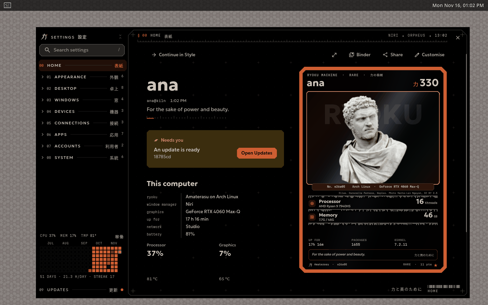
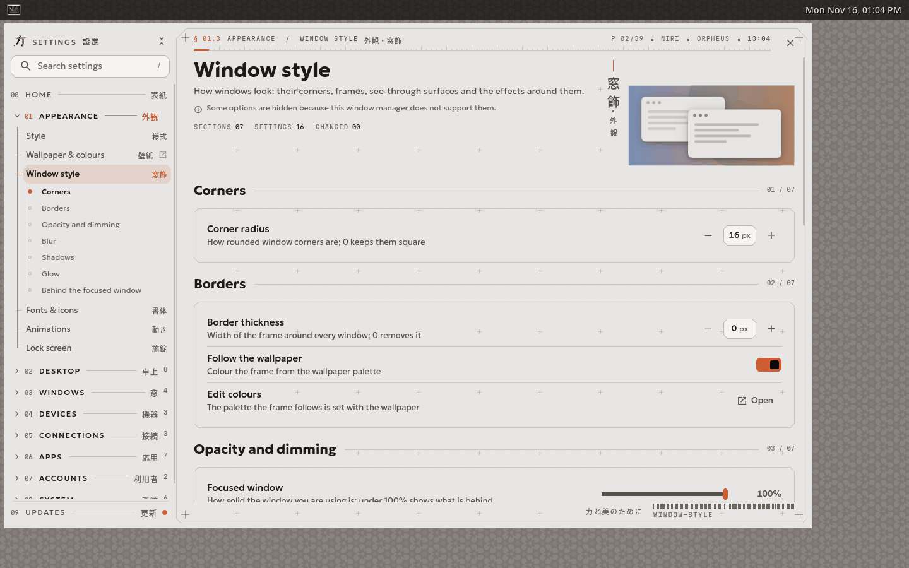

# UI and UX

Ryoku has one UI language, and Ryoku Settings is its reference. Settings (the
Hub, `ryoku/hub/quickshell/`, run as `qs -c hub`) draws every rule on this page
today: a printed sheet with cut corners, a numbered index, ruled ticks, a kanji
gloss behind one switch, dithered sculpture plates, quiet plaques with one gold
action, changes that apply at once with Undo, and a little life only while the
window is in use. Every other surface, the bar, the dock, the launcher, the
panels, the lock screen, Kit and the apps, takes the same language. The Hub is
the reference; the other surfaces are being brought to it.

This page is the language applied across Ryoku: what each part is, where the Hub
shows it, and what each surface should do. The design system behind it is
[docs/lithic/](lithic/README.md); this page links there for detail instead of
repeating it. How Settings itself is built and extended is
[docs/hub.md](hub.md).

*Home in Ryoku's own colours: the sidebar tree, the masthead, the name and its
tick ruler, the one toned slab with its gold plaque, the readings and the
system card.*

## The language in short

1. **A printed sheet, not app chrome.** Under every page lies a registration
   sheet of faint dots and corner crosses (`components/sheet/RegSheet.qml`);
   over it a mono masthead, at its foot a colophon
   (`components/sheet/Masthead.qml`, `Colophon.qml`).
2. **A numbered index.** Home is `00`, categories `01` to `08`, Updates `09`,
   pages `CC.N`, sections `01 / 08`, and the masthead gives the page's place
   among all pages, `P 02/39` (`registry/numbering.js`).
3. **Ruled ticks.** A tick ruler under the masthead carries the scroll marker,
   Home's motto sits on one, section heads are ruled, and the system card's
   data code is three tick rulers (`components/TickRuler.qml`).
4. **Kanji gloss, behind one switch.** Every category and page has its real
   Japanese word, shown only while `UiPreferences.showJapaneseGloss` is on
   (`registry/registry.js`).
5. **Dithered art.** Classical sculpture photographs set as a live 1-bit dither
   in the ink (`components/sheet/Plate.qml`, `shaders/plate.frag`).
6. **Cut corners and plaques are the watermark.** Every plane is a `CutRect`
   with 45 degree chamfers; every button is a plaque. No rounded corner in the
   Lithic style.
7. **Quiet first, one gold.** Almost every action is a quiet plaque; the one
   consequential action of a view is gold.
8. **A change applies when it is made.** No Save, no action bar; a notice names
   the change and offers Undo (`Singletons/Changes.qml`).
9. **Life at rest only while in use.** A clock, a scan across the plates and
   live figures move only while Settings is the focused window and motion is
   not reduced (`Singletons/Ambient.qml`).
10. **Plain voice.** Sentences to "you", plain verbs, no em-dash.

The names used here (sheet, masthead, colophon, folio, plate, registration
sheet, tick ruler, gloss, Tategaki, plaque tiers, sidebar tree, outline and
section nodes, notices with Undo) are defined in
[the vocabulary](lithic/design.md#2-vocabulary). Use exactly those words in
code, comments and reviews.

Paths below are relative to `ryoku/hub/quickshell/` unless they start with
`ryoku/` or `docs/`. The Lithic library is `docs/lithic/library/qml/Lithic/`.

## Style and colour

### Roles: never hardcode a value

The reader chooses two things once, in Settings › Appearance › Style, and every
Ryoku surface follows both live:

- **The design style** (`theme.design`): Lithic (the default and the language
  this page describes), Material, Adwaita or Fluent. A style changes only
  corners and how the planes are layered.
- **The colours** (`theme.colours`): **Ryoku's own** (the ryoku.dev palette with
  its orange sun accent, the default) or **the wallpaper's** Matugen palette.
  Choosing Ryoku's colours replaces the wallpaper scheme completely; nothing of
  the wallpaper lingers. Light or dark (`theme.mode`: Dark, Light, Automatic
  from the wallpaper, Sun from the time of day), contrast (standard or high)
  and, for Lithic on the wallpaper's colours, tint (off, low, medium) apply to
  either.

The two are independent: changing the style never resets the colours, and the
other way round. The Style page shows each design in a preview marked
"EXAMPLE" whose controls change nothing (`pages/Style.qml`). The rule every
surface meets and where the choice lives: [styles.md](lithic/styles.md). How a
palette becomes roles, for Ryoku's colours and for the wallpaper's:
[palette.md](lithic/palette.md).

This guidance holds no colour values. A surface reads **roles**; the values live
only in [tokens.json](lithic/tokens.json) and the generated token files. A hex
in a surface is a bug, with two exceptions that are content, not chrome: badge
role inks and art.

| Role | What it is for |
|---|---|
| `ground` | the paper every plane lies on |
| `stone1` to `stone4`, `slab` | planes by place; `stone4` for menus, popovers and dialogs; `slab` for a section's container |
| `field`, `edge` | what you type into or choose from, and its hairline |
| `vein` | hairlines, rules and quiet outlines |
| `fg`, `fg2`, `fg3` | strong, secondary and faint ink; `fg2` carries most text |
| `sel`, `onSel` | the accent: a mark of place, and the fill of a toggle that is on, a chosen segment, a slider handle, a notice |
| `container`, `containerInk` | the soft wash under a selection (the open page in the tree) |
| `gold`, `onGold`, `goldInk` | the action: the one consequential plaque, and line plaques |
| `jade`, `lapis`, `amber`, `jasper` | state, always beside its word: alive, becoming, needs you, failed |
| `scrim` | behind a dialog or drawer |

How the Hub applies them (`Singletons/Tone.qml`, `Lithic.qml`):

- **Planes come from `Lithic.planes()`.** In Lithic the sidebar and the page are
  one paper set apart by a 1 px `vein` hairline; Material lifts the page,
  Adwaita sets the sidebar apart, Fluent outlines layered planes.
- **The accent marks place only:** the masthead's `§` numeral, the open line's
  numeral, mark and gloss in the tree, the scroll marker, the section being
  read, lit spec facts, the Updates dot (`components/nav/NavRow.qml`,
  `components/sheet/Masthead.qml`).
- **Washes are alphas of `fg`:** the tree's hover, press, hairline and guide
  (`Tone.qml`). There is no grey on light-grey pairing; a plane is the paper,
  and ink sits on it at its role.
- **Gold is the action.** It also marks rarity and winners on cards and in the
  binder (`components/about/Binder.qml`, `BinderCompare.qml`). On Fedora, NixOS
  and Void an edition accent takes the action colour; the accent stays Ryoku's.
- **Minerals are fixed per mode**, never wallpaper-driven, and never carry a
  state alone: "Up to date" in jade, "Checking for updates" in lapis, "Needs
  you" as the one amber slab, errors as `jasper` detail text
  (`components/Home.qml`).

Two kinds of content keep their own colour. A music surface tints from the
album sleeve, because album art is data, not chrome
(`ryoku/shell/quickshell/shell/utils/artcolor.js`). A surface that floats on
the wallpaper with no plane under it (the desktop clock, the spectrum) corrects
its role against the wallpaper it actually sits on with `Ink.legible`
(`ryoku/ui/Singletons/Ink.qml`).

## Type

Two faces, nothing else ([design.md](lithic/design.md#4-type)):

- **Geologica** for everything a person reads.
- **Martian Mono** for data, numbering and running heads.

Icons are Material Symbols Sharp. Kanji come from the system CJK face (Noto Sans
CJK JP). The Lithic library bundles both text faces (`Lithic.qml`), so a surface
never names a font.

The Hub's roles (`LithicTokens.qml`; size and line in px):

| Role | Size | Weight | Where the Hub uses it |
|---|---|---|---|
| `name` | 52/56 | Bold | the one monument: Home's name |
| `sentence` | 34/40 | Bold | dialog titles; page titles at 32/40 (`components/PageHeader.qml`) |
| `section` | 21/28 | Bold | section titles, Home's readings |
| `title`, `row` | 15/20 | Medium | setting-row titles, search hits, Tategaki kanji |
| `proof` | 15/21 | Regular | Home's motto |
| `body` | 14/20 | Regular | page leads, dialog text |
| `label` | 13/16 | Medium | plaque text, slider values, search group heads |
| `detail` | 13/18 | Regular | row details, tree leaves, crumbs, errors; the most used role |
| `caption` | 12/16 | Regular | notes, outline section names, glosses |
| `group` | 12/16 | Medium | folder names in spaced capitals, the sidebar title |
| `mono` | 10/16 | Regular | `user@host`; the folio numeral at 168 |
| `monoSm` | 9/15 | Regular | the masthead, tree numerals, spec strip, section ordinals, plate credits |

- **Spaced capitals** are part of the sheet: tree folder names, the sidebar
  title, the masthead, spec-strip labels, the Activity summary and card heads,
  tracked 0.6 to 2 (`NavRow.qml`, `HubSidebar.qml`, `Masthead.qml`). Titles,
  rows, details and sentences are in sentence case.
- **Mono counts the sheet.** Index and counts are zero-padded mono: `01.3`,
  `P 02/39`, `SECTIONS 08 · SETTINGS 16 · CHANGED 03`. Readings a person
  watches (Home's clock and figures, a slider's value) are sans with tabular
  figures.
- **Weight marks selection:** the open leaf, a folder name and the section being
  read are DemiBold.
- **Ink by role:** `fg2` carries most text; `fg` is kept for titles, values and
  what is selected or hovered.

**The kanji gloss.** Every category and page has its real Japanese word ("Latin
names the thing, the kanji is its seal", `registry/registry.js`). It shows on
each tree line, in the masthead, set vertically beside the page's plate
(`components/sheet/Tategaki.qml`), huge beside the folio, and in the colophon's
motto 力と美のために, all behind `UiPreferences.showJapaneseGloss` (Fonts & icons ›
Show Japanese glosses, on by default). Three kanji are marks, not glosses, and
always show: the 力 before the card's power, the 力 on the empty binder's card,
and the role kanji in a badge's hanko. Any surface that adds a gloss gates it
the same way ([design.md](lithic/design.md#kanji-gloss)).

## Shape

A cut is a 45 degree chamfer measured along one edge. Draw every shape as a
`CutRect` with its cut; each style turns the cut into its own corner (Material,
Adwaita and Fluent round it), so nothing sets a radius by hand. The cut scales
with the thing ([design.md](lithic/design.md#5-shape-the-cut-scale)):

| Cut | Where |
|---|---|
| 3 | tokens |
| 4 and 2 | the toggle track and its knob |
| 5 | a segment inside its track |
| 6 | tree rows, icon buttons, search hits, small plaques |
| 7 | plaques, fields, section slabs, the page pane's foot, the peek card |
| 8 | menus, popovers, notices |
| 16 | the page pane's top corners, dialogs, the binder |
| 22 and 14 | the system card and its face |

- **Hairlines are 1 px `vein`,** drawn inside the outline. Setting rows are 13
  apart with a hairline centred in the gap (`SettingRow.qml` in the library).
- **Focus** is a 2 px `fg2` ring 2 outside the cut; Hub rows and icon buttons
  stroke their own cut in `fg2` instead.
- **Plaques by tier** ([components.md](lithic/components.md)): `quiet` (no edge
  or fill at rest, so its words line up with the column) for almost
  everything; `line` for secondary actions; `gold` for the one consequential
  action of a view; `tonal` for Related links and list actions; `danger` and
  `dangerLine` for destructive confirms; `on` for a notice's Undo. A plaque is
  40 tall, or 32 small; the Hub uses small almost everywhere. A press deepens
  the cut by 4 and sinks the content 1.
- **Hexagon-like boxes.** The chamfered planes, slabs and plaques are Settings'
  faceted boxes. The one literal hexagon pattern is the faint `hexgrid` behind
  the badge certificate (`components/badge/Certificate.qml`).
- **What is still round:** the outline's section nodes (5 px circles, 7 for the
  section being read, `NavOutline.qml`) and the 8 px accent dot on Updates
  while an update is ready (`NavRow.qml`).
- **No shine tells.** No lit top edge on a button, no vertical accent bar on the
  left of an option, no gradient on chrome. The Hub draws one hard offset
  shadow, under the tree's peek card (`HubSidebar.qml`), and a drop shadow under
  the system card's seal (`TradingCard.qml`).

## Space

One run: `s1` 4, `s2` 8, `s3` 13, `s4` 21, `s5` 34, `s6` 55
([design.md](lithic/design.md#6-space)). The Hub lives mostly on `s2` and `s3`;
a slab's inset is `s4`, Home's groups are `s5` apart, and Home's side margin
is `s6` on a roomy window. The frame's own offsets (8, 10, 22, 28) are the
frame's, not gaps between things.

## Layout

A Ryoku app is a **desktop window**, not a phone-shaped panel. Settings opens
at 1280×800 and never smaller (`ShellBody.qml`); refinement borrowed from
Android shows in layout and motion, never in the form factor. Detail and the
other app shapes: [layout.md](lithic/layout.md).

*Window style: the open folder with its outline, the masthead, the 32 px title
with Reset page, the spec strip, Tategaki and the live preview, then ruled
sections of rows.*

**The frame** (`Hub.qml`):

- **Sidebar tree**, 272 wide, always shown at the window's size. Its head is the
  Ryoku mark and "SETTINGS 設定" with one action that shuts every folder; under
  it the search field, which replaces the tree with results while there is a
  query; then the tree: Home `00`, numbered folders with their names in spaced
  capitals and a leader to the gloss and page count, leaves hung on a guide
  line, the open page's sections hanging under it as an outline; under the tree
  the Activity map, a contribution graph of the machine's uptime; at the foot
  `09 UPDATES`. Resting on a line shows a peek card with its live summary
  (`components/nav/`).
- **Page pane** on the same paper, cut 16 at the top and 7 at the foot, with the
  masthead over the page, the stage, and the colophon (motto and the page id as
  a Code 39 barcode). A page that fits leaves its foot to the **folio**, its
  number set huge and faint (`components/sheet/Folio.qml`).
- Below 880 wide (only when a compositor forces it) the sidebar becomes a
  drawer under a scrim.

**A settings page** (`components/SettingsPage.qml`, `PageHeader.qml`):

- One reading column, `min(width, 960)`, centred.
- **The head:** the title, the page's own plaques on its line, a one-sentence
  lead, a state line, a note when the window manager hides rows, and a **spec
  strip** of facts; at the right the page's live preview, or its category's
  dithered plate with Tategaki beside it.
- **Sections**, ruled, numbered `01 / 08`, each a slab of setting rows: title
  over detail at the left, the control right-aligned and at most 320 wide.
  Rarely used rows fold under **More options**; a page that names related pages
  ends on **Related**.
- **No Save.** A change applies when made. A **notice** (placard) rises at the
  window's foot naming it, with Undo, and drains over five seconds; Ctrl+Z
  undoes too, and Home keeps "Recently changed".
- Search lands on a row and flashes it once.

**Home** is the profile plate (`components/Home.qml`): who (name, `user@host`
and clock, motto, tick ruler), what waits (one claim line, or the toned "Needs
you" slab carrying the view's one gold), "This computer" (a datasheet and four
readings, each over an **engraved chart**), and "Recently changed" with Undo,
beside the dithered figure or the system card. Overview screens present data
with graphs this way: a value, a chart, and its proof
([components.md](lithic/components.md)).

**Overlays:** a dialog is a `stone4` plane cut 16 on the scrim, 520 wide, title
in `sentence`, closing on Escape or a press outside; a destructive confirm has a
quiet Cancel and a `danger` action, may ask for a name to be typed, and may
count down and revert by itself (`confirm()` in `Hub.qml`, drawn by the
library's `Confirm`). Info buttons open a `stone4` popover cut 8. The Hub has no
tooltips; the tree's peek is its hover explanation. Escape closes the topmost
thing only.

**Apps shaped around a list of resources.** Rashin, an app with fleets of
agents, tasks and worktrees, uses parts the Hub does not: the **tablet** (a
resource row, `ryoku/rashin/internal/app/pages/projects/overview.go`), the
**notch** and **flake** that carry a row's state beside its word
(`teamsui/notched.go`, `chat/answer.go`), **tabs** between views
(`pages/teams/page.go`) and a **skeleton** while loading (`look/states.go`).
They follow the same roles, cuts, type and motion.

## Motion

Detail: [motion.md](lithic/motion.md). Motion must feel smooth at high refresh
(165 Hz); nothing may read as 30 frames a second.

**Curves.** OutCubic is the Hub's working curve; Lithic's components use the
chisel curve (`Lithic.curve`). The tree chevron (overshoot 1.6) and the section
node (overshoot 2) use OutBack (`NavRow.qml`, `NavOutline.qml`). Pointer-follow
uses `Chase` (`components/Chase.qml`): a frame-rate independent approach that
never overshoots and looks the same at 60 and 165 Hz. No springs.

**Durations** (`Tone.qml`; all pass through `Lithic.duration`, so they are zero
under reduced motion):

| Name | ms | Name | ms |
|---|---|---|---|
| `Tone.quick` | 120 | press | 90 |
| `Tone.move` | 240 | hover | 160 in, 100 out |
| `Tone.unfold` | 260 | navigate (scroll jumps) | 200 |
| `Tone.stagger` | 18 | dialog | 300 in, 160 out |
| reveal stagger | 40 | notice in, notice life | 300, 5000 |

**What moves, and why:**

- **Hover and press:** a tree row's wash fades in over 120 and out over 240 and
  the row leans 2 px; a plaque's fill eases and a press deepens its cut; the
  close glyph turns 90 degrees on hover.
- **A page opens:** the stage fades in over 240 and slides 14 px into place over
  300; its first five sections rise 8 px in turn, 40 ms apart; a rebuild after
  that moves nothing.
- **The tree:** a folder unfolds over 260 and its leaves slide in 18 ms apart;
  the selection wash slides within a folder or lands at a new one.
- **The sheet:** the folio's number rolls over 480; a plate develops from the
  top over 1100; the Activity map prints in once over 900.
- **Overlays:** a dialog rises 12 as it enters; a notice rises 8.
- **Finite loops only:** the Updates dot pulses three times and rests; progress
  blades and the three-flake `Working` run only while a job is live.

**Life at rest** ([design.md](lithic/design.md#what-may-move-at-rest)). While
Settings is the focused window and motion is not reduced, `Ambient` runs a one
second clock, a scan that crosses the plates every 11 s (stepped at 30 frames a
second), Home's dust motes (about 15 frames a second) and the live figures.
Between scans nothing moves, and an unfocused window draws nothing. Cards are
still until pointed at. Two things go on at rest: the badge emblem's rim turns
while the studio's Badge tab is open, and Home's rim light is a still layer.

**Reduced motion** (`theme.motion.reduce`) makes every duration zero, stops
`Ambient`, `Reveal` and `Chase`, swaps the folio at once, shows the plates
developed, and keeps cards and the emblem still; a notice still leaves on its
timer.

## Copy

Detail: [copy.md](lithic/copy.md).

- Second person, plain verbs, the same word through a whole flow. Sentences end
  with a period; labels do not. No em-dash, no exclamation mark, no emoji in
  chrome.
- Sentence case, except the sheet's running heads and folder names in spaced
  capitals.
- Errors say what happened and what to do next. A state comes with its proof.
- Never mention AI or design tools in product copy.
- Separators: " › " in crumbs, "  /  " in the masthead, " · " in facts and
  summaries, "・" between kanji.

From the Hub: "How every Ryoku surface looks: its design, its colours, and light
or dark." (a page lead); "Width of the frame around every window; 0 removes it"
(a row detail); "Log out now?" / "Every open app closes, and work you have not
saved is lost." (a confirm); "No settings match “blur”" then "Nearby pages"
(search); "The desktop service is not answering, so what Settings shows may be
out of date and changes may not take." (a service down).

## Art

Art is content: it may curve, glow or shade, and the chrome around it stays cut.

- **Plates.** Each category carries a classical sculpture photograph, regraded
  to grey and set live as a 1-bit ordered 4×4 Bayer dither in the ink, with the
  credit its licence asks for (`registry/plates.js`, `shaders/plate.frag`).
  Corner ticks register the plate; it develops in from the top, and the
  `Ambient` scan crosses it.
- **The figure.** Home's figure is a sculpture photograph too (the Caracalla
  Farnese), drawn as photo, black and white, or dots, under a light set in 2 px
  dots (`components/about/CardFigure.qml`, `shaders/light.frag`).
- **The system card** (`components/about/TradingCard.qml`) follows these rules:
  - The foil is smooth, never dotted, and capped at 0.6 alpha
    (`shaders/foil.frag`). Shine stays restrained.
  - Rarity climbs Common, Uncommon, Rare, Holo rare, Ultra rare, Secret rare
    (`registry/rarity.js`). From Ultra rare the figure breaks the window. Secret
    rare is the most spectacular and unlike Ultra rare: a diamond-faceted border
    (`shaders/diamond.frag`), an etched mineral foil, a gilded name, four-colour
    sparkles, a beating ★★★ and a gold sweep.
  - Every effect needs the pointer; a card at rest is a still.
  - A shared card restores from the image alone: the card's data code is drawn
    in its three tick rulers, as part of the design, with no visible QR code and
    no hidden metadata (`components/about/CardShare.qml`). Cards are signed by
    neur0map.
- **Baked decor.** Decor images are baked at dev time and committed, reduced to
  one ink: `ryodither` for photographs and sculpture, `ryoduo` for line art that
  a dither would break. Both write to `ryoku/assets/ryodecors`; the contract and
  tools are `bin/art/README.md`. Shell and Settings art ships as PNG, because
  Quickshell's Qt build has no webp plugin.
- **The logo** is the current mark, the cut 力 in ink and accent:
  `ryoku/assets/brand/logo-mark-v2.png` and `wordmark-v2.png`, drawn in QML by
  `components/RyokuMark.qml`. The older brand files beside them
  (`logo-mark.png`, `logo-mark.svg`, `logo.svg`) and the Lithic library's
  `BrandMark` are not the logo. Rashin wears a sibling seal, the same tile
  carrying 十 (`ryoku/assets/brand/rashin-mark.svg`).

## Each surface

Every surface meets the same contract:

- Reads the style and the colours from the desktop and follows a change live,
  in all four styles, Ryoku's colours and the wallpaper's, dark and light,
  standard and high contrast ([checklist.md](lithic/checklist.md#styles-and-colours)).
- Uses roles, the two faces, the cut scale and the space run; no hex, no font
  name, no radius in the surface.
- Quiet plaques, one gold per view; state as a mineral beside its word.
- Glosses behind `showJapaneseGloss`; no lit edges, left bars or shine on chrome.
- Escape closes the topmost thing; reduced motion stops everything; nothing
  moves at rest unless the surface is focused and in use.

In QML the way to meet it is the Lithic library, as the Hub does
([working.md](lithic/working.md) has the cutover for a surface). The targets
below are what each surface becomes.

- **Frame and bar.** The bar is an instrument strip in the masthead's manner:
  facts in mono with " · " separators, workspace numbers zero-padded, the
  focused workspace marked by the accent. Popouts that grow from it (network,
  audio, battery, recording, the keyring and polkit prompts) are `stone4` cut
  slabs with a hairline, holding setting rows and quiet plaques. The frame's
  outer shape and its physical give stay the frame's own
  ([frame.md](frame.md)). Ryoku ships two subshells: **Orpheus**, the top bar
  and fallback, takes the Hub's language; **Kairos** keeps its Android-style
  look by design. Store bar styles own their look by contract
  ([subshells.md](subshells.md)); where one offers a Lithic face, it follows
  this page.
- **Dock.** A cut plate on a hairline, apps as icons in cut wells; the open or
  focused app marked in the accent; a menu is a cut `stone4` popover. Every dock
  design shares the same pins and model; their looks are their own, and
  Ryoku's design takes this language ([stage.md](stage.md)).
- **Launcher** (`Super+Space`). The Hub's search, as a window: one field,
  results grouped under `label` heads, matched words underlined, each hit's
  crumb in `detail`, the cursor hit on the hover plane, a hand-off marked
  `open_in_new`. Modes are a Segmented; provider prefixes show in mono. The rest
  card (clock, greeting, weather) sets its figures as Home does
  ([launcher.md](launcher.md)).
- **Quick settings** (`Super+Escape`). A short sheet: ruled sections of setting
  rows, levels as sliders with their value in tabular figures, vitals as
  engraved charts with a value and proof, connections as claims with their
  proof, session actions as plaques with the danger tier for power-off
  ([sidebars.md](sidebars.md)).
- **Ask, clipboard, voice.** A `stone4` cut plane with one field. Rows take the
  hover plane, never a left accent bar; an answer streams as body text. Nothing
  breathes or glows while idle.
- **Notifications.** Ryoku's own card takes the design in use, switched live
  from `theme.design` (`modules/notifications/NotificationLook.qml`,
  `designs/`). Each look sets the column's width, gap and settle
  (`designs/Stack.js`), arrives from the edge `notification_position` names
  and holds its slot until its exit ends. Every card has the app and a short
  time ("now", "3 min"), open, expand and close, the summary, the body clamped
  to two lines until expanded, actions on expand, the image or app icon when
  `show_images`, and a mark for critical urgency. Lithic is a 360 slip cut
  top-left and bottom-right with a hairline, a mono `APP · NOW` header, cut
  plaque actions, a tick fuse that burns down the lifespan and a jasper URGENT
  stamp. Material is a 360 M3 card with the app in a tonal circle wrapped by a
  draining wavy ring. Adwaita is GNOME's 380 banner with no countdown. Fluent
  is the Windows 11 364 toast with acrylic grain and one reveal light round
  its outline. Countdowns step on a timer and hold still with reduced motion,
  and the window exists only while a card is up.
  `bin/art/notification-previews` records each look for Settings.
- **Capture** (ryoshot, `Super+Shift+S`). One model, four placements, switched
  live from `theme.design` (`ryoshot/CaptureBar.qml`, `designs/`, primitives in
  `look/`). Lithic is a 36-tall ruled strip flush on the bottom edge: mono
  slugs with their keys, ticks lit over the chosen action, a shine once on
  entry. Material is a 56-tall floating toolbar 24 up with a connected action
  group and a FAB for the screen. Adwaita is GNOME's capture panel 36 up with
  big target toggles and a shutter. Fluent is the Snipping Tool bar 16 under
  the top bar's zone with sliding indicators. The bar shows only on the output
  under the pointer and steps aside while dragging, picking or waiting.
  Beautify (`ryoshot/beautify/`) lifts the selection into a card beside its
  panel: Lithic's numbered sheet flush on the right edge, Material's side
  sheet, Adwaita's sidebar card, Fluent's acrylic pane. One `Composition.qml`
  draws the stage, the look thumbnails and the export, which is rendered on
  demand at the exact style.
- **OSD.** The volume, microphone, brightness and keyboard layout pop-up is a
  glance, not a panel: one small look per design, switched live from
  `theme.design` (`modules/osd/OsdLook.qml`, `designs/`), each where its
  platform puts it. Lithic is a 232x30 tab that slides out from under the bar
  with a tick ruler and a rolling mono figure. Material is Android's 44x184
  edge slider 12 from the right with a flowing squiggle level. Adwaita is
  GNOME's 260x44 pill 56 above the bottom. Fluent is the Windows 11 196x48
  flyout 28 above the bottom with a ringed thumb. There is no caption: past
  100% reads in jasper beyond a 100 mark and muted greys the level. It animates
  only while shown, holds still with reduced motion, and its window exists
  only while it is up. `bin/art/osd-previews` records each look for Settings
  on the shared harness `bin/art/qmlrecord.py`.
- **Overview** (`Super+Tab`). Workspace numbers in zero-padded mono, cells as
  cut planes on hairlines, the focused one marked by the accent; no private
  palette.
- **Session confirm.** The Hub's confirm: title in `sentence`, a plain
  consequence sentence, quiet Cancel, the act in a `danger` plaque.
- **Kit** (`Super+K`). A Hub-shaped tool window: a sidebar tree of its tools
  (Keys, Commands, Phone, Dev tools, Typing test) under one search that replaces
  the tree with results; shortcuts set as keycaps (cut token plates on `field`
  with an `edge` hairline, as `ChordField` draws them).
- **Desktop widgets and the Stage Editor.** A widget plate is a cut plane, or no
  plane with `Ink.legible` ink over the wallpaper. Stage Editor chrome (toolbar,
  drawer, inspectors) is setting rows and Segmented choices on cut slabs.
- **Wallpaper and spectrum.** Content, not chrome: the spectrum may glow and
  curve (below).
- **Lock screen and greeter.** A lock skin is a whole look of its own and
  installs from RyoStore (`ryoku/lockscreen/qylock/`). Ryoku's own skin takes
  this language: the clock and date set as Home sets its clock, the name in the
  `name` role, one password field cut 7, the error as a `jasper` sentence, the
  desktop's style and colours, and no loop at rest.
- **Apps.** Rashin (`ryoku/rashin/cmd/rashin-app`) and Ryotunes draw with the
  Lithic Go library (`docs/lithic/library/go`); Ryotunes keeps its music-first
  layout and may tint from the album art. RyoStore, Welcome, ryoshot, ryopin and
  the Ryogami picker take the Hub's sheet, plaques and type, and so does
  Ryoport, the optional fleet app.
- **Terminals and toolkits.** Kitty, GTK, Qt and the CLI consoles use Martian
  Mono or Geologica and the chosen colours ([theming.md](theming.md)); a
  terminal UI uses the Lithic `term` package.

### The desktop spectrum

The audio visualiser is art on the wallpaper. It draws on a click-through
layer-shell field per monitor (bottom layer, or top in overlay mode) and never
takes input outside the Stage Editor. Every look is one GPU pass
(`ryoku/ui/shaders/spectrum.frag`), and the desktop and its preview share
`Ryoku.Ui.SpectrumField`, so they cannot drift. The placement maths (lean,
turn, sizing a turned box from its opposite corner) lives in
`ryoku/ui/lib/place.js` with its tests in `place.test.mjs`. Colour is the
palette's accent, re-lit through `Ink` only when the wallpaper is too close in
tone. Motion is budgeted: one timer at the configured rate, halved while the
audio idles, stopped on silence. Placement and the catalogue:
[stage.md](stage.md#the-visualizer-in-the-stage-editor).

## Building it

- **Settings** imports Lithic and adapts it in `Singletons/Tone.qml`; it uses
  the non-visual singletons of `Ryoku.Ui` (`I18n`, `Bus`, `UiPreferences`,
  `Spawn`, ...) and none of its visual parts. Extending it: [hub.md](hub.md).
- **Shell surfaces** read `Ryoku.Ui` (`ryoku/ui/`, its `Singletons/Tokens.qml`)
  and `shell/services/Scheme.qml` today; their target is the Lithic library, a
  whole surface at a time ([working.md](lithic/working.md)). A local
  `Theme.qml` may name roles; it never defines values.
- **Where `Ryoku.Ui` loads from.** An installed system reads it from
  `/usr/lib/qt6/qml/Ryoku/Ui`. A deploy.sh checkout installs it under
  `~/.local/lib/qt6/qml`, which only the daemon puts on the import path
  (`ryoku/shell/ipc/daemon.go`) and `ryoku/hyprland/modules/env.lua` sets for
  the session; if an import fails in dev and works on an installed box, that is
  why. Packages compile it (`ryoku/ui/CMakeLists.txt`, `build.sh`); a dev box
  copies the sources (`install.sh`). A new type is a line in the `qmldir`; a
  module file imports `Ryoku.Ui.Singletons` by name, never by relative path.
- **Gio apps** use the Lithic Go library: `palette` for the roles, `kit` for
  every shape ([library/go/README.md](lithic/library/go/README.md)).
- **Prototype live.** Run the shell from the checkout with
  `ryoku/shell/dev-run.sh` (hot reload) and tune against the running surface;
  wire state through `ryoku-shell`, not the view.
- **Check it.** Walk [checklist.md](lithic/checklist.md) in each style, both
  colour sources, dark and light, then look: a capture of the running surface
  (`grim -o <output> shot.png`) set beside the Hub's renders in
  `docs/lithic/media/hub-*.png` is the proof.
- **Research** unfamiliar controls and protocols in primary sources (the
  Quickshell, Qt and Hyprland documentation, the Arch Wiki) and confirm on the
  running system.
